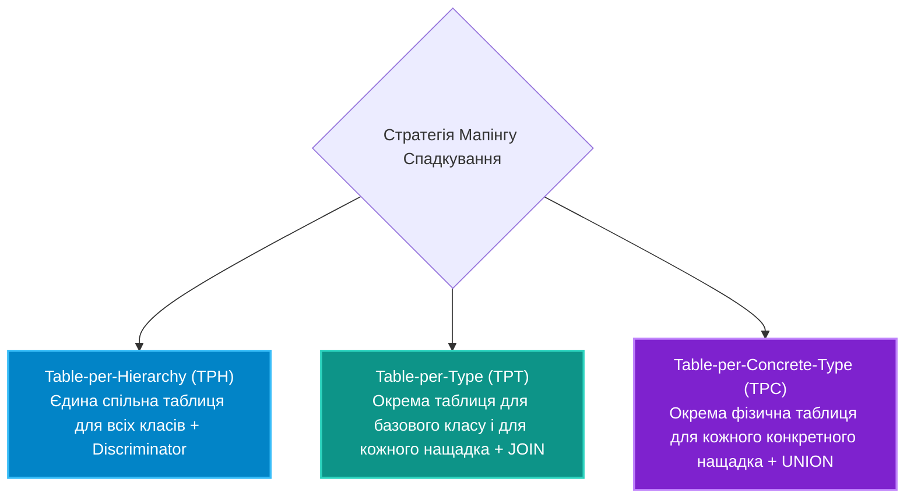

# 05. Стратегії мапінгу спадкування: TPH, TPT та TPC

## 1. Проблема відображення поліморфізму в реляційні БД

В об'єктно-орієнтованому програмуванні спадкування є природним:
```csharp
public abstract class Payment { public int Id; public decimal Amount; }
public class CreditCardPayment : Payment { public string CardNumber; }
public class CryptoPayment : Payment { public string WalletAddress; }
```

Однак у реляційних базах даних поняття "спадкування таблиць" стандартом SQL безпосередньо не підтримується. Entity Framework Core пропонує три фундаментальні стратегії проектування таких ієрархій:



---

## 2. Детальний аналіз трьох стратегій

### 1. Table-per-Hierarchy (TPH) — Стратегія за замовчуванням
Усі класи ієрархії зберігаються в **одній таблиці**. Для визначення типу використовується стовпець-дискримінатор (`Discriminator`).
* **Плюси:** Найвища швидкість поліморфних запитів (жодних `JOIN` чи `UNION`).
* **Мінуси:** Стовпці підкласів зобов'язані бути `NULLABLE` у БД.

### 2. Table-per-Type (TPT)
Створюється окрема таблиця для базового типу та окрема таблиця для кожного нащадка. Дочірні таблиці посилаються на первинний ключ базової через Foreign Key.
* **Плюси:** Нормалізована схема БД, колонки можуть бути `NOT NULL`.
* **Мінуси:** Поліморфні запити вимагають важких `LEFT JOIN` між усіма таблицями ієрархії.

### 3. Table-per-Concrete-Type (TPC) — Додано у .NET 7
Базовий клас таблиці не має взагалі. Кожен конкретний нащадок отримує повністю незалежну фізичну таблицю з усіма полями (включаючи базові).
* **Плюси:** Висока швидкість запитів до конкретного нащадка, чиста нормалізація без зайвих колонок.
* **Мінуси:** Поліморфний запит базового класу `context.Payments.ToList()` транслюється у важкий SQL `UNION ALL`.

---

## 3. Конфігурація у Fluent API

```csharp
// Налаштування TPT:
modelBuilder.Entity<Payment>().UseTptMappingStrategy();

// Налаштування TPC:
modelBuilder.Entity<Payment>().UseTpcMappingStrategy();

// Налаштування TPH (кастомний дискримінатор):
modelBuilder.Entity<Payment>()
    .HasDiscriminator<string>("PaymentType")
    .HasValue<CreditCardPayment>("CreditCard")
    .HasValue<CryptoPayment>("Crypto");
```

---

## 4. Порівняльна матриця стратегій спадкування

| Параметр | TPH (Table-per-Hierarchy) | TPT (Table-per-Type) | TPC (Table-per-Concrete) |
|:---|:---|:---|:---|
| **Кількість таблиць** | Рівно 1 таблиця | $1 + N$ таблиць | $N$ таблиць |
| **Стовпець Discriminator** | Обов'язковий | Не потрібен | Не потрібен |
| **Обмеження NOT NULL на полях нащадків** | Неможливо (тільки NULL) | Дозволено (повна нормалізація) | Дозволено |
| **Швидкість запиту до конкретного класу** | Максимальна | Повільніша (JOIN з базовою) | Максимальна (прямий SELECT) |
| **Швидкість поліморфного виклику `Payments`** | Максимальна (простий SELECT) | Повільна (багатосторонній JOIN) | Середня (вимагає SQL UNION ALL) |

---

## 5. Матриця проєкту цієї секції

| Проєкт | Посилання на вихідний код | Що демонструє під капотом |
|:---|:---|:---|
| [`05-InheritanceStrategiesTphTptTpc`](../05-InheritanceStrategiesTphTptTpc/Program.cs) | [Program.cs](../05-InheritanceStrategiesTphTptTpc/Program.cs) | Практичне зіставлення TPH, TPT та TPC моделей, інспекція згенерованого SQL для кожної стратегії та аналіз структури таблиць. |
