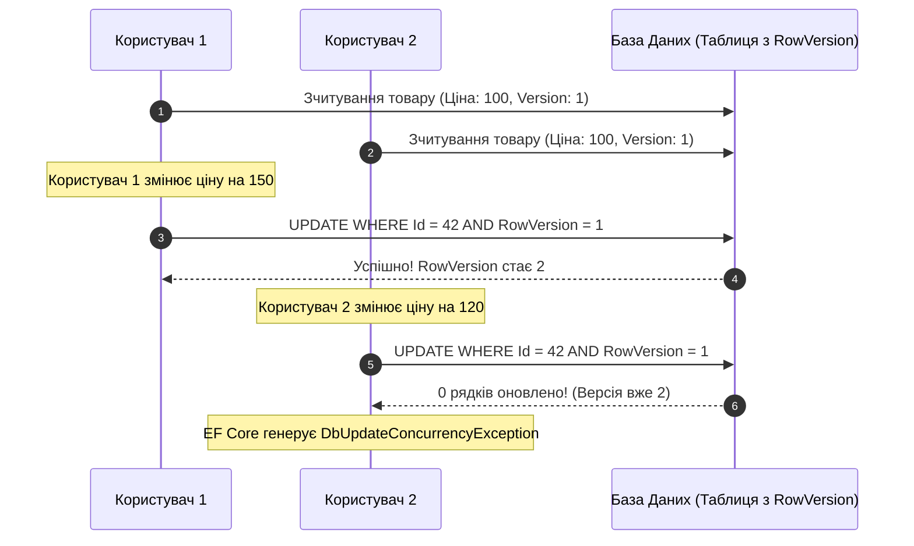

# 06. Сирий SQL, Транзакції та Оптимістичне Блокування (Concurrency)

## 1. Безпечне виконання сирого SQL без ризику SQL Injection

Коли можливостей компілятора LINQ недостатньо для специфічних аналітичних операцій (наприклад, віконні функції, ієрархічні CTE або специфічні оператори СУБД), використовується виконання прямого SQL.

### Механізм `FromSqlInterpolated` проти вразливого `FromSqlRaw`

```csharp
// ПОГАНО: Вразливість до SQL Injection при конкатенації рядків!
string search = "'; DROP TABLE Orders; --";
var bad = await context.Orders.FromSqlRaw($"SELECT * FROM Orders WHERE Title = '{search}'").ToListAsync();

// ДОБРЕ: FromSqlInterpolated АВТОМАТИЧНО параметризує інтерпольовані змінні!
string safeSearch = "Книга";
var orders = await context.Orders
    .FromSqlInterpolated($"SELECT * FROM Orders WHERE Title LIKE {'%' + safeSearch + '%'}")
    .AsNoTracking()
    .ToListAsync();
```

---

## 2. Керування транзакціями: `IDbContextTransaction`

За замовчуванням кожен виклик `SaveChangesAsync()` вже виконується всередині транзакції. Проте, якщо бізнес-операція включає виклики кількох контекстів, зовнішніх систем або низькорівневих команд, необхідне явне керування:

```csharp
await using IDbContextTransaction transaction = await context.Database.BeginTransactionAsync();
try
{
    // 1. Списання балансу покупця
    await context.Database.ExecuteSqlInterpolatedAsync(
        $"UPDATE Wallets SET Balance = Balance - {orderCost} WHERE UserId = {userId}");

    // 2. Створення замовлення
    context.Orders.Add(new Order { CustomerId = userId, Total = orderCost });
    await context.SaveChangesAsync();

    // Підтвердження атомарної транзакції:
    await transaction.CommitAsync();
}
catch (Exception)
{
    // Відкат у разі будь-якого збою:
    await transaction.RollbackAsync();
    throw;
}
```

---

## 3. Оптимістичне блокування (Optimistic Concurrency Control)

Коли два користувачі одночасно зчитують один запис і намагаються його відредагувати, без контролю конкурентності відбудеться **тихий перезапис даних (Lost Update)**.

У .NET для вирішення цієї проблеми застосовується **токен конкурентності (Concurrency Token / RowVersion)**:



### Налаштування токена конкурентності у Fluent API

```csharp
builder.Entity<Product>()
    .Property(p => p.RowVersion)
    .IsRowVersion(); // Прапорець [Timestamp] автоматично оновлюється базою даних на кожен запис
```

### Обробка конфлікту паралелізму в C# коді:

```csharp
try
{
    await context.SaveChangesAsync();
}
catch (DbUpdateConcurrencyException ex)
{
    foreach (var entry in ex.Entries)
    {
        var proposedValues = entry.CurrentValues; // Що хоче зберегти користувач
        var databaseValues = await entry.GetDatabaseValuesAsync(); // Що вже збережено в БД

        // Доменна стратегія вирішення конфлікту: прийняти версію БД або перезаписати
        entry.OriginalValues.SetValues(databaseValues);
    }
}
```

---

## 4. Порівняльна таблиця стратегій блокувань

| Стратегія | Механіка | Переваги | Недоліки |
|:---|:---|:---|:---|
| **Песимістичне блокування (Pessimistic)** | Блокування рядків у БД (`SELECT FOR UPDATE`) | 100% гарантія захисту від конфліктів | Блокує інші читання, викликає черги та Deadlock |
| **Оптимістичне блокування (Optimistic)** | Перевірка `RowVersion` при виклику `UPDATE` | Висока масштабованість, блокування відсутні | Необхідність писати логіку повтору при конфліктах |

---

## 5. Матриця проєкту цієї секції

| Проєкт | Посилання на вихідний код | Що демонструє під капотом |
|:---|:---|:---|
| [`06-RawSqlTransactionsAndConcurrency`](../06-RawSqlTransactionsAndConcurrency/Program.cs) | [Program.cs](../06-RawSqlTransactionsAndConcurrency/Program.cs) | Виконання безпечного параметризованого `FromSqlInterpolated`, ручне керування транзакціями та емуляція `DbUpdateConcurrencyException` із розв'язанням колізій. |
