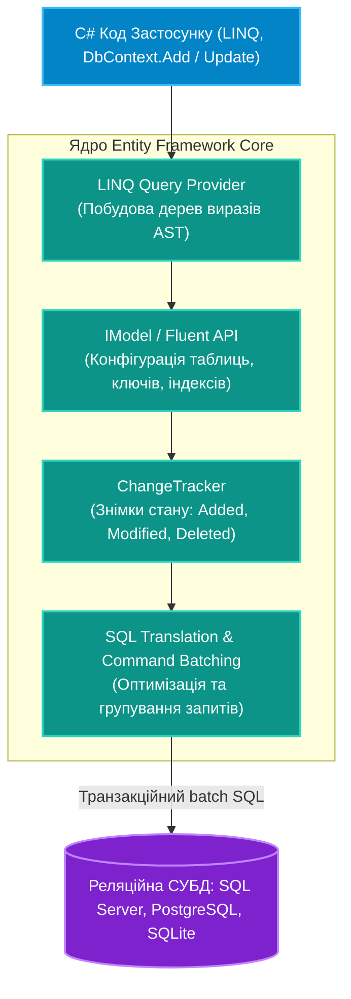

# Підмодуль 01: Повний курс володіння Entity Framework Core (`OOP - EF Core Complete Mastery.sln`)

Цей підмодуль є фундаментальним ядром для вивчення сучасного ORM (Object-Relational Mapping) на платформі .NET — **Entity Framework Core**. Тут детально розбираються внутрішні механізми взаємодії з реляційними базами даних: від низькорівневого трекера змін `ChangeTracker` та конфігурації моделей через Fluent API до оптимізації важких LINQ-запитів, розв'язання проблеми Cartesian Explosion, стратегій мапінгу спадкування (TPH/TPT/TPC), оптимістичного блокування та виконання сирого SQL.

---

## Архітектурний конвеєр Entity Framework Core

---

## Навігація по навчальних посібниках (`Docs`)

| № | Посібник | Ключові теми та системні інструменти | Посилання на документ |
|:---:|:---|:---|:---|
| 01 | **Життєвий цикл DbContext та ChangeTracker** | Архітектура Unit of Work, механізм знімків (snapshots), стани `EntityState`, вартість `DetectChanges()` | [Docs/01_DbContext_CRUD_And_ChangeTracker.md](Docs/01_DbContext_CRUD_And_ChangeTracker.md) |
| 02 | **Моделювання сутностей: DataAnnotations та Fluent API** | Принцип пріоритету налаштувань, тіньові властивості (Shadow Properties), конвертери значень (Value Converters), поля резервного копіювання | [Docs/02_Entity_Modeling_Annotations_And_FluentAPI.md](Docs/02_Entity_Modeling_Annotations_And_FluentAPI.md) |
| 03 | **Зв'язки між сутностями та стратегії завантаження** | Навігаційні зв'язки 1:1, 1:N, N:M, каскадне видалення `DeleteBehavior`, завантаження Eager, Explicit, Lazy та `AsSplitQuery()` | [Docs/03_Relationships_Cascade_And_Loading.md](Docs/03_Relationships_Cascade_And_Loading.md) |
| 04 | **LINQ to Entities, Проєкції та Відстеження** | Трансляція `IQueryable` в SQL, відмінність від `IEnumerable`, оптимізація через `AsNoTracking()`, пагінація та скомпільовані запити | [Docs/04_Linq_To_Entities_Queries_And_Tracking.md](Docs/04_Linq_To_Entities_Queries_And_Tracking.md) |
| 05 | **Стратегії мапінгу спадкування (TPH, TPT, TPC)** | Поліморфні моделі в реляційних БД: Table-per-Hierarchy (дискримінатори), Table-per-Type (JOIN) та Table-per-Concrete-Type (UNION) | [Docs/05_Inheritance_Strategies_TPH_TPT_TPC.md](Docs/05_Inheritance_Strategies_TPH_TPT_TPC.md) |
| 06 | **Сирий SQL, Транзакції та Конкурентність** | Захист від SQL Injection через `FromSqlInterpolated`, пряме виконання команд, транзакції `IDbContextTransaction`, оптимістичне блокування `[Timestamp]` | [Docs/06_RawSql_Transactions_And_Concurrency.md](Docs/06_RawSql_Transactions_And_Concurrency.md) |

---

## Каталог проєктів рішення `OOP - EF Core Complete Mastery.sln`

* **`01-DbContextCrudAndChangeTracker`**:
  * Робота з `DbContext` як Unit of Work, ручне перемикання станів через `context.Entry(entity).State`.
  * Демонстрація генерації батчів `INSERT`/`UPDATE` при єдиному виклику `SaveChangesAsync()`.
  * Посилання на вихідний код: [`Program.cs`](01-DbContextCrudAndChangeTracker/Program.cs).
* **`02-EntityModelingAnnotationsAndFluentApi`**:
  * Моделювання сутностей за допомогою Fluent API (`EntityTypeBuilder`).
  * Тіньові властивості для аудиту (`CreatedAt`, `UpdatedAt`) без забруднення C# класу.
  * Посилання на вихідний код: [`Program.cs`](02-EntityModelingAnnotationsAndFluentApi/Program.cs).
* **`03-RelationshipsAndLoadingStrategies`**:
  * Налаштування зв'язків один-до-одного, один-до-багатьох та багато-до-багатьох із кастомними таблицями переходів.
  * Порівняння `Include` vs `AsSplitQuery` для запобігання Cartesian Explosion.
  * Посилання на вихідний код: [`Program.cs`](03-RelationshipsAndLoadingStrategies/Program.cs).
* **`04-LinqToEntitiesQueriesAndTracking`**:
  * Побудова складних проєкцій за допомогою оператора `Select(dto => ...)`.
  * Прискорення запитів лише на читання через `AsNoTracking()`.
  * Посилання на вихідний код: [`Program.cs`](04-LinqToEntitiesQueriesAndTracking/Program.cs).
* **`05-InheritanceStrategiesTphTptTpc`**:
  * Порівняння трьох підходів мапінгу ієрархій класів на фізичні реляційні таблиці.
  * Аналіз згенерованого SQL для поліморфних запитів.
  * Посилання на вихідний код: [`Program.cs`](05-InheritanceStrategiesTphTptTpc/Program.cs).
* **`06-RawSqlTransactionsAndConcurrency`**:
  * Безпечне виконання складних аналітичних звітів через сирий SQL.
  * Обробка винятків `DbUpdateConcurrencyException` при одночасному редагуванні одного запису.
  * Посилання на вихідний код: [`Program.cs`](06-RawSqlTransactionsAndConcurrency/Program.cs).
