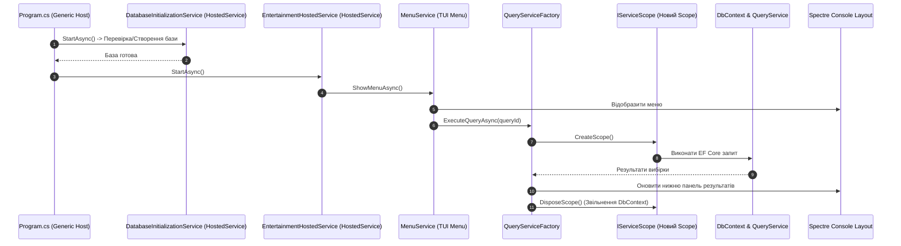

# Архітектура Generic Host та Hosted Services у консольних додатках

Сучасні консольні додатки на .NET використовують **Generic Host (`Microsoft.Extensions.Hosting`)**, що надає ті самі корпоративні можливості, які доступні в ASP.NET Core: інверсію керування (DI), структуроване конфігурування (`appsettings.json`), логування та життєвий цикл фонових служб (`IHostedService`).

---

## 1. Концепція архітектури та потік виконання



---

## 2. Керування часом життя `DbContext` через Scoped Services

Оскільки консольний додаток є довгоживучим процесом, збереження одного екземпляра `DbContext` на весь час роботи програми є антипатерном (призводить до витоків пам'яті через ChangeTracker та проблем із застарілими даними).

### Патерн Scope Factory:
```csharp
public async Task<TResult> ExecuteQueryAsync<TResult>(Func<IQueryService, Task<TResult>> queryAction)
{
    // Створюється ізольований скоуп для одного запиту
    using var scope = _serviceScopeFactory.CreateScope();
    
    // Отримуємо DbContext та QueryService, прив'язані до цього скоупу
    var queryService = scope.ServiceProvider.GetRequiredService<IQueryService>();
    
    // Виконуємо операцію
    return await queryAction(queryService);
    
    // При виході з блоку using контекст коректно звільняється
}
```

---

## 3. Ініціалізація бази даних через `DatabaseInitializationService`

Перед початком роботи меню спеціальний HostedService автоматично перевіряє наявність SQLite бази даних, застосовує міграції або заповнює початковими даними (Seed Data):

```csharp
public class DatabaseInitializationService : IHostedService
{
    private readonly IServiceProvider _serviceProvider;

    public async Task StartAsync(CancellationToken cancellationToken)
    {
        using var scope = _serviceProvider.CreateScope();
        var dbContext = scope.ServiceProvider.GetRequiredService<EntertainmentDbContext>();
        
        await dbContext.Database.MigrateAsync(cancellationToken);
        await SeedDataAsync(dbContext);
    }

    public Task StopAsync(CancellationToken cancellationToken) => Task.CompletedTask;
}
```
