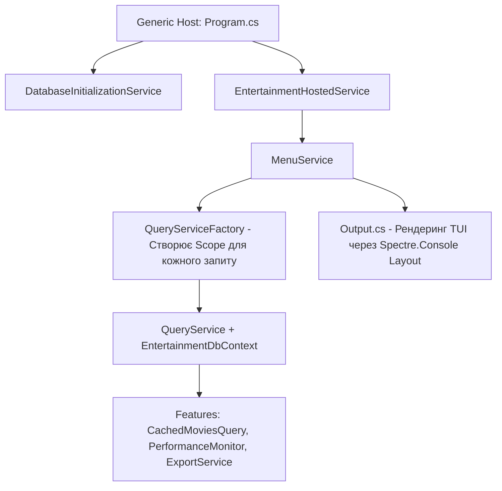

# Модуль 19: Практичні сценарії EF Core: Generic Host, Кешування, Профайлінг та TUI (Full-Stack CLI Application)

Фінальний модуль курсу об'єднує всі вивчені технології — **Entity Framework Core (SQLite)**, **Generic Host**, **Dependency Injection**, **Serilog**, **Кешування**, **Моніторинг продуктивності** та інтерактивний інтерфейс на базі **Spectre.Console** в єдиному повноцінному додатку.

---

## 🧭 Навігація по навчальних матеріалах

1. [Архітектура Generic Host та Hosted Services у консольних додатках](Docs/01_Generic_Host_And_Hosted_Services.md)
2. [Комплексна доменна модель та практичні EF Core запити](Docs/02_Complex_EFCore_Domain_And_Queries.md)
3. [Наскрізна функціональність: Кешування, Експорт, Профайлінг та TUI-відображення](Docs/03_Cross_Cutting_Concerns_Cache_Export_Perf.md)

---

## 🏛️ Архітектура рішення `OOP-EF-Core-Entertainment.sln`



### Компоненти додатку:

| Директорія | Вміст | Призначення |
| :--- | :--- | :--- |
| **`Models/`** | `Actor`, `Movie`, `Series`, `Character`, `Production`, `Rating`, `EntertainmentDbContext` | Доменна модель медіаіндустрії з конфігурацією моделей через Fluent API та SQLite. |
| **`Services/`** | `EntertainmentHostedService`, `MenuService`, `DatabaseInitializationService`, `QueryServiceFactory` | Фонова служба додатку, життєвий цикл бази даних, генерація скоупів запитів, інтерактивне меню. |
| **`Quieries/`** | `Queries`, `IQueryService` | Складні запити до бази: проекції DTO, фільтри за зв'язками, агрегації рейтингів, оптимізація через `AsNoTracking()`. |
| **`Features/`** | `CacheService`, `PerformanceMonitor`, `ExportService` | Декоратори кешування запитів у пам'яті, профайлінг часу виконання операцій та експорт вибірок у JSON/CSV. |
| **`Migrations/`** | EF Core міграції | Автоматично згенеровані міграції для розгортання схеми бази даних у SQLite. |

---

## 🛠️ Як зібрати та запустити

```powershell
# Збірка додатку
dotnet build "07-DataAccess-EFCore/02-EFCore-Practical-Scenarios/OOP-EF-Core-Entertainment.sln" -c Release

# Запуск інтерактивного додатку розваг
dotnet run --project "07-DataAccess-EFCore/02-EFCore-Practical-Scenarios/Entertainment/OOP-EF-Core-Entertainment.csproj"
```
