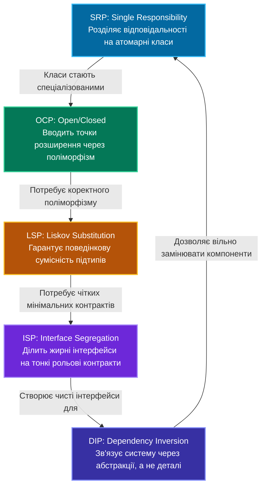

# Підмодуль 01: Практичний курс з об'єктно-орієнтованого проєктування — Принципи SOLID у C# (.NET 10)

Ласкаво просимо до повного практичного курсу з принципів **SOLID** — фундаментального набору рекомендацій та патернів архітектури програмного забезпечення, що лежить в основі розробки надійних, масштабованих та тестованих систем.

Цей підмодуль створено у форматі інтерактивного навчального посібника («живого підручника») для розробників, студентів та інженерів. Кожен принцип проілюстровано парними прикладами: **проблемною реалізацією (Bad)**, яка демонструє типові антипатерни реальних проєктів, та **еталонною архітектурою (Good)**, побудованою за канонічними інженерними підходами на платформі .NET.

---

## Зміст курсу та швидка навігація

| Літера | Назва принципу | Фокус проєктування | Повна лекція курсу | Поганий код (Bad) | Еталонний код (Good) |
|:---:|:---|:---|:---:|:---:|:---:|
| **S** | **Single Responsibility (SRP)** | Єдина зона відповідальності, висока когезія | [01_Single_Responsibility.md](Docs/01_Single_Responsibility_Principle.md) | [ `OrderProcessorBad.cs`](OOP%20-%20SOLID/S/OrderProcessorBad.cs) | [ `OrderProcessorGood.cs`](OOP%20-%20SOLID/S/OrderProcessorGood.cs) |
| **O** | **Open/Closed (OCP)** | Відкритість до розширення, закритість для змін | [02_Open_Closed.md](Docs/02_Open_Closed_Principle.md) | [ `PaymentProcessorBad.cs`](OOP%20-%20SOLID/O/PaymentProcessorBad.cs) | [ `PaymentProcessorGood.cs`](OOP%20-%20SOLID/O/PaymentProcessorGood.cs) |
| **L** | **Liskov Substitution (LSP)** | Надійність підстановки підтипів, контракти | [03_Liskov_Substitution.md](Docs/03_Liskov_Substitution_Principle.md) | [ `BirdBad.cs`](OOP%20-%20SOLID/L/LSPBadExample/BirdBad.cs) | [ `BirdGood.cs`](OOP%20-%20SOLID/L/LSPGoodExample/BirdGood.cs) |
| **I** | **Interface Segregation (ISP)** | Розділення інтерфейсів, рольові контракти | [04_Interface_Segregation.md](Docs/04_Interface_Segregation_Principle.md) | [ `IWorkerBad.cs`](OOP%20-%20SOLID/I/ISPBadExample/IWorkerBad.cs) | [ `RobotWorkerGood.cs`](OOP%20-%20SOLID/I/ISPGoodExample/RobotWorkerGood.cs) |
| **D** | **Dependency Inversion (DIP)** | Інверсія залежностей, абстракції | [05_Dependency_Inversion.md](Docs/05_Dependency_Inversion_Principle.md) | [ `UserServiceBad.cs`](OOP%20-%20SOLID/D/DIPBadExample/UserServiceBad.cs) | [ `UserServiceGood.cs`](OOP%20-%20SOLID/D/DIPGoodExample/UserServiceGood.cs) |
| **D+**| **DIP  IoC  DI  Container** | Еволюційний практикум (Abstract Factory, Pure DI, Lifetimes) | [06_DIP_IoC_DI_Containers_DeepDive.md](Docs/06_DIP_IoC_DI_Containers_DeepDive.md) | [ `UserServiceWithFactory.cs`](OOP%20-%20SOLID/DIP_IoC_DI_Evolution/Step2_AbstractFactory_IoC/UserServiceWithFactory.cs) | [ `UserServiceWithDI.cs`](OOP%20-%20SOLID/DIP_IoC_DI_Evolution/Step3_DependencyInjection/UserServiceWithDI.cs)<br/>[ `SimpleContainer.cs`](OOP%20-%20SOLID/DIP_IoC_DI_Evolution/Step4_IoCContainer/MiniContainer/SimpleContainer.cs) |

---

## 1. Вступ та історія: Навіщо потрібен SOLID?

Акронім **SOLID** був уведений Майклом Фізерсом (Michael Feathers) на початку 2000-х років для систематизації п'яти фундаментальних принципів, сформульованих Робертом С. Мартіном («Дядько Боб», Robert C. Martin).

У реальних проєктах програмне забезпечення рідко залишається статичним. Бізнес-вимоги змінюються, додаються нові платіжні системи, методи сповіщень, сховища даних та правила валідації. Якщо дизайн системи не підготовлений до змін, виникає явище, відоме як **деградація архітектури (Architectural Decay / Software Rot)**.

### Симптоми «гниючого коду» (Code Rot):

1. **Жорсткість (Rigidity)**:
   - Зміна в одному модулі спричиняє лавину вимушених правок у багатьох залежних компонентах. Навіть дрібна зміна оцінюється як тривала та ризикована задача.
2. **Крихкість (Fragility)**:
   - Внесення змін ламає функціональність у місцях, концептуально взагалі не пов'язаних із місцем модифікації (ефект метелика).
3. **Немобільність (Immobility)**:
   - Неможливість повторно використати корисний фрагмент коду в іншій частині програми або в іншому проєкті, оскільки він занадто сильно «прив'язаний» до поточного оточення.
4. **В'язкість (Viscosity)**:
   - Архітектурно «правильне» рішення настільки громіздке й незручне для впровадження, що розробник обирає шлях «костилів» і швидких хаків, чим ще сильніше руйнує систему.

**Принципи SOLID є цілісною вакциною проти цих симптомів.**

---

## 2. Синергія принципів SOLID

Початківці часто розглядають п'ять принципів окремо один від одного. Проте справжня сила архітектурного проєктування виникає саме тоді, коли принципи працюють **у синергії**:



### Як принципи взаємодоповнюють один одного:
1. **SRP** визначає **межі відповідальності** класів. Замість монолітів ми отримуємо компактні, сфокусовані компоненти.
2. **OCP** показує, як зробити ці класи відкритими до майбутнього, замінюючи каскадні перевірки `switch/if` на **поліморфізм**.
3. **LSP** гарантує, що класи-спадкоємці поліморфного ланцюжка **не порушать очікувань клієнта** та не призведуть до раптових винятків типу `NotSupportedException`.
4. **ISP** захищає клієнтський код від надлишкових обов'язків, формуючи **вузькоспеціалізовані інтерфейси**.
5. **DIP** збирає всю систему разом: високорівнева бізнес-логіка перестає залежати від SQL-баз, сокетів чи файлової системи, а оперує виключно **контрактами (абстракціями)**.

---

## 3. Огляд прикладів підмодуля

Підмодуль структуровано за відповідними папками:

```
01-SOLID-Principles/
│
├── OOP - SOLID.sln          # Рішення Visual Studio з українськими Solution-теками
├── README.md                # Головний навчальний силабус (цей файл)
└── OOP - SOLID/
    ├── Docs/                # 6 фундаментальних лекцій із SOLID та IoC/DI
    ├── S/                   # Single Responsibility Principle
    ├── O/                   # Open/Closed Principle
    ├── L/                   # Liskov Substitution Principle
    ├── I/                   # Interface Segregation Principle
    ├── D/                   # Dependency Inversion Principle
    ├── DIP_IoC_DI_Evolution/# Еволюція: DIP -> Factory -> Pure DI -> IoC Container
    ├── IMenuCommand.cs      # Інтерфейс патерну Command для консольного термінала
    └── Program.cs           # Головне меню програми та реєстрація демонстраційних команд
```

---

## 4. Патерн проєктування Command в інтерактивній оболонці

Точка входу програми (`Program.cs`) спроєктована з використанням класичного патерну проєктування **Command (Команда)**. Замість монолітної конструкції `switch-case` в меню вибору, кожна демонстрація інкапсульована в окремому об'єкті, що реалізує інтерфейс `IMenuCommand`:

```csharp
public interface IMenuCommand
{
    string Title { get; }
    void Execute();
}
```

Такий підхід демонструє дотримання **OCP** та **SRP** вже на рівні самої програми: додавання нової демонстрації не вимагає переписування коду навігації в меню.

---

## 5. Інструкція із запуску та перевірки збірки

Для запуску демонстраційної консольної програми потрібен встановлений SDK **.NET 10.0**.

```powershell
# Збірка рішення
dotnet build "08-Architecture-And-Patterns/01-SOLID-Principles/OOP - SOLID.sln" -c Release

# Запуск інтерактивного меню
dotnet run --project "08-Architecture-And-Patterns/01-SOLID-Principles/OOP - SOLID/OOP - SOLID.csproj"
```

---

## 6. Баланс між SOLID та прагматизмом: Уникнення Overengineering

Застосування принципів SOLID є ознакою високої культури інженерії, однак досвідчений архітектор завжди пам'ятає про баланс:

> «Абстракція без необхідності — це технічний борг, створений наперед.»

### Інженерна тріада поруч із SOLID:
1. **KISS (Keep It Simple, Stupid)**: Найпростіше робоче рішення часто є найкращим. Не створюйте фабрику фабрик або 15 шарів абстракцій там, де достатньо одного простого класу.
2. **YAGNI (You Aren't Gonna Need It)**: Не впроваджуйте точки розширення OCP під сценарії, які існують лише у вашій уяві. Розширюйте систему тоді, коли з'являється реальна бізнес-вимога.
3. **DRY (Don't Repeat Yourself)**: Усувайте дублювання знань, але не плутайте випадкову схожість коду зі справжнім дублюванням бізнес-логіки.
