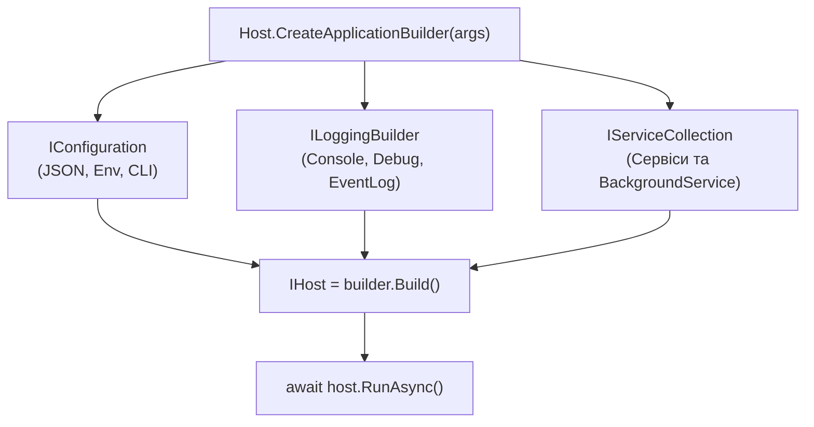

# 01. Архітектура Generic Host та Фонові служби (`IHost`, `BackgroundService`)

У сучасній екосистемі .NET будь-який нетривіальний консольний застосунок, фоновий сервіс обробки черг чи системний демон будується навколо уніфікованого каркасу — **Generic Host** (`Microsoft.Extensions.Hosting`).

---

## 1. Навіщо потрібен Generic Host?

У класичних навчальних консольних програмах метод `Main` часто перетворюється на хаотичний скрипт, де вручну створюються об'єкти, відкриваються файли конфігурації та запускаються нескінченні цикли `while (true)`. Такий підхід має критичні вади:
- Відсутня стандартизована обробка сигналів завершення процесу (`Ctrl+C`, `SIGINT`, `SIGTERM` у контейнерах або системних службах Windows/Linux).
- Немає єдиного механізму конфігурації, логування та контейнера інверсії керування (DI).
- Фонові потоки обриваються примусово посеред транзакції при закритті вікна термінала.

**`IHost` (Універсальний Хост)** інкапсулює всі інфраструктурні ресурси застосунку в одному об'єкті:
1. **Контейнер залежностей (`IServiceProvider`)** — керує створенням і часом життя компонентів.
2. **Конфігурацію (`IConfiguration`)** — збирає налаштування з `appsettings.json`, змінних середовища та аргументів CLI.
3. **Систему логування (`ILoggerFactory` / `ILogger<T>`)** — маршрутизує діагностичні повідомлення.
4. **Керування життєвим циклом (`IHostApplicationLifetime`)** — координує запуск і граційну зупинку всіх фонових служб (`IHostedService`).



---

## 2. Життєвий цикл хоста та `IHostApplicationLifetime`

Інтерфейс `IHostApplicationLifetime` дозволяє будь-якому сервісу підписатися на три ключові стани застосунку через властивості типу `CancellationToken`:

| Властивість | Момент спрацювання | Типове призначення |
|:---|:---|:---|
| **`ApplicationStarted`** | Усі зареєстровані `IHostedService.StartAsync` успішно завершилися. | Логування готовності системи, відправка сигналу «Healthy» у систему моніторингу. |
| **`ApplicationStopping`** | Отримано сигнал зупинки (`Ctrl+C` або виклик `StopApplication()`), але `StopAsync` служб ще триває. | Припинення прийому нових задач із черги, скидання буферів на диск. |
| **`ApplicationStopped`** | Усі служби завершили `StopAsync`, хост от-от звільнить ресурси. | Фінальний запис у журнал про коректний вихід. | Крім того, метод `_lifetime.StopApplication()` дозволяє **будь-якому фоновому воркеру** ініціювати штатне завершення всього застосунку (наприклад, коли пакетне завдання виконано до кінця або виявлено критичну помилку конфігурації).

---

## 3. Контракт `IHostedService` проти `BackgroundService`

### 3.1. Інтерфейс `IHostedService`
Це базовий контракт для будь-якої керованої хостом служби:
```csharp
public interface IHostedService
{
    Task StartAsync(CancellationToken cancellationToken);
    Task StopAsync(CancellationToken cancellationToken);
}
```
> [!IMPORTANT]
> Хост викликає `StartAsync` для кожної служби **послідовно в порядку їх реєстрації** та **чекає** завершення `Task`, перш ніж перейти до наступної служби! Тому в `StartAsync` не можна запускати нескінченний блокуючий цикл `while` — це заблокує старт усього застосунку. `IHostedService` ідеально підходить для **коротких підготовчих задач** (перевірка з'єднання з базою даних, прогрів кешу).

### 3.2. Абстрактний клас `BackgroundService`
Для тривалих циклічних процесів (опитування черги, моніторинг, робота за таймером) у .NET передбачено базовий клас `BackgroundService`, який сам реалізує `IHostedService` і запускає метод `ExecuteAsync(CancellationToken stoppingToken)` у фоновому режимі:

```csharp
public sealed class TelemetryProcessingWorker : BackgroundService
{
    protected override async Task ExecuteAsync(CancellationToken stoppingToken)
    {
        using var timer = new PeriodicTimer(TimeSpan.FromMilliseconds(250));
        while (await timer.WaitForNextTickAsync(stoppingToken))
        {
            // Корисне навантаження циклу
        }
    }
}
```

---

## 4. Граційна зупинка (Graceful Shutdown) та `ShutdownTimeout`

Коли користувач натискає `Ctrl+C` або хост викликає `StopApplication()`:
1. Токен `stoppingToken`, переданий у `ExecuteAsync`, переходить у стан `IsCancellationRequested = true`.
2. Асинхронні операції (`PeriodicTimer.WaitForNextTickAsync`, `Task.Delay`, `DbContext.SaveChangesAsync`) миттєво викидають `OperationCanceledException` і переривають очікування.
3. Хост чекає завершення методу `StopAsync` усіх воркерів протягом часу, заданого в `HostOptions.ShutdownTimeout` (за замовчуванням 30 секунд).

Практичну реалізацію можна переглянути та запустити у проєкті [`01-GenericHostLifecycleAndWorkers`](../01-GenericHostLifecycleAndWorkers/Program.cs).
