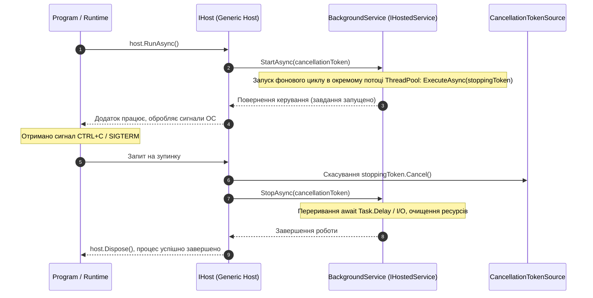

# 01. Generic Host та Фонові Сервіси (`IHostedService`, `BackgroundService`)

## 1. Архітектура та призначення Generic Host

У ранніх версіях .NET для побудови додатків існував розрив: консольні утиліти писалися вручну без стандартизованої ініціалізації, тоді як веб-додатки використовували розвинений `WebHost`. Починаючи з .NET Core 2.1 і отримавши сучасний вигляд у .NET 7/8/9, платформа надає **Generic Host** (`Microsoft.Extensions.Hosting`).

Generic Host інкапсулює всі базові ресурси довгоживучого процесу:
* **Dependency Injection (DI)** — реєстрація та резолв залежностей через `IServiceCollection`.
* **Configuration** — каскадне об'єднання джерел (`appsettings.json`, змінні оточення, аргументи CLI).
* **Logging** — уніфікований конвеєр журналювання подій через `ILoggerFactory`.
* **Lifetime Management** — відстеження сигналів ОС (SIGTERM, CTRL+C), запуск фонових воркерів та плавна зупинка (`Graceful Shutdown`).

Сучасний підхід базується на класі **`HostApplicationBuilder`**, який надає інтуїтивний та лаконічний API налаштування перед остаточною збіркою контейнера:

```csharp
HostApplicationBuilder builder = Host.CreateApplicationBuilder(args);

// Реєстрація залежностей та фонових служб:
builder.Services.AddHostedService<QueueProcessingWorker>();

using IHost host = builder.Build();
await host.RunAsync();
```

---

## 2. Діаграма життєвого циклу хоста та фонової служби



---

## 3. Порівняння: `IHostedService` проти `BackgroundService`

Для запуску коду у фоні .NET пропонує два контракти:

1. **`IHostedService`** — низькорівневий інтерфейс із методами `StartAsync` та `StopAsync`. Якщо в методі `StartAsync` виконати тривалу або блокуючу роботу (наприклад, нескінченний цикл `while`), хост заблокується і взагалі не зможе запустити решту служб.
2. **`BackgroundService`** — рекомендований абстрактний клас, що реалізує `IHostedService`. Він делегує виконання абстрактному методу `ExecuteAsync(CancellationToken stoppingToken)` у фоновий потік пулу, уникаючи блокування ініціалізації хоста.

### Антипатерн проти рекомендованої реалізації

```csharp
// ПОГАНО: Блокування StartAsync в IHostedService зупиняє старт усього хоста!
public class BadWorker : IHostedService
{
    public async Task StartAsync(CancellationToken cancellationToken)
    {
        while (!cancellationToken.IsCancellationRequested) // ПОМИЛКА: Нескінченний цикл блокує старт хоста!
        {
            await Task.Delay(1000);
        }
    }
    public Task StopAsync(CancellationToken cancellationToken) => Task.CompletedTask;
}

// ДОБРЕ: Спадкування від BackgroundService з коректним graceful shutdown
public class GoodWorker : BackgroundService
{
    private readonly ILogger<GoodWorker> _logger;

    public GoodWorker(ILogger<GoodWorker> logger) => _logger = logger;

    protected override async Task ExecuteAsync(CancellationToken stoppingToken)
    {
        _logger.LogInformation("Фоновий воркер запущено.");
        while (!stoppingToken.IsCancellationRequested)
        {
            try
            {
                await Task.Delay(2000, stoppingToken);
                _logger.LogInformation("Ітерація обробки черги успішна.");
            }
            catch (OperationCanceledException) when (stoppingToken.IsCancellationRequested)
            {
                _logger.LogWarning("Отримано сигнал зупинки. Завершення фонового циклу...");
                break;
            }
        }
    }
}
```

---

## 4. Порівняльна характеристика типів хостингу

| Параметр | Старий підхід (Console App) | Generic Host (`HostApplicationBuilder`) | WebHost (`WebApplication`) |
|:---|:---|:---|:---|
| **Призначення** | Одноразові скрипти, алгоритмічні тести | Демони, черги, бекграунд-воркери, CLI | Веб-сервіси, REST API, gRPC, Blazor |
| **Життєвий цикл** | Ручне керування, ризик раптового аварійного виходу | Повна підтримка Graceful Shutdown та сигналів ОС | Graceful Shutdown для HTTP-з'єднань |
| **Ін'єкція залежностей** | Відсутня або ручне створення ServiceProvider | Вбудований стандартний DI-контейнер .NET | Повний DI-контейнер із Web-специфічними скоупами |
| **Конфігурація** | Ручний парсинг аргументів `args` або файлів | Каскадне злиття JSON, Environment Variables, CLI | Каскадне злиття з додатковими endpoints |

---

## 5. Матриця проєкту цієї секції

| Проєкт | Посилання на вихідний код | Що демонструє під капотом |
|:---|:---|:---|
| [`01-GenericHostLifecycleAndWorkers`](../01-GenericHostLifecycleAndWorkers/Program.cs) | [Program.cs](../01-GenericHostLifecycleAndWorkers/Program.cs) | Конфігурація `HostApplicationBuilder`, реєстрація фонового працівника через `AddHostedService<T>`, обробка `CancellationToken` та коректне очищення пам'яті при зупинці процесу. |
