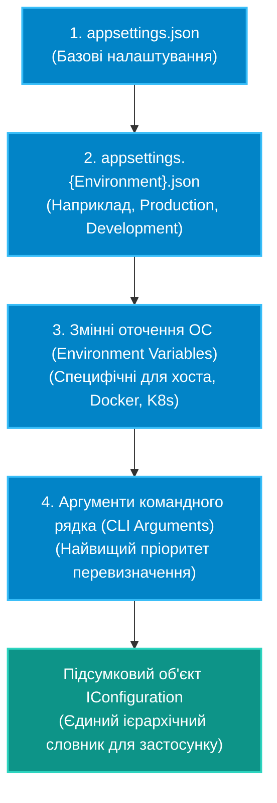

# 02. Конфігурація застосунку та Патерн Options (`IOptions`, `IOptionsSnapshot`, `IOptionsMonitor`)

## 1. Ієрархія джерел конфігурації в .NET

Система конфігурації в .NET побудована як набір шарів провайдерів ключ-значення (`IConfiguration`). При створенні `HostApplicationBuilder` за замовчуванням конфігурується ланцюжок джерел, де кожне наступне джерело перекриває (override) значення попередніх:



---

## 2. Патерн Options: типізований доступ до налаштувань

Замість "магічних рядків" на зразок `config["DatabaseSettings:ConnectionString"]`, у сучасному C# використовується **Options Pattern**. Конфігурація проектується на чисті типізовані класи (POCO).

### Сімейство інтерфейсів Options

| Інтерфейс | Час життя в DI | Підтримка Hot-Reload | Область використання |
|:---|:---|:---:|:---|
| **`IOptions<T>`** | **Singleton** | Ні | Одноразове зчитування під час старту. Не реагує на зміни файлу конфігурації. Ідеально для фіксованих системних параметрів. |
| **`IOptionsSnapshot<T>`** | **Scoped** | Так | Перераховується для кожного нового Scope (наприклад, на кожен HTTP-запит або обробку повідомлення черги). |
| **`IOptionsMonitor<T>`** | **Singleton** | Так | Підтримує підписку на подію зміни конфігурації `OnChange` без створення нових скоупів. Підходить для фонових служб `BackgroundService`. |

---

## 3. Практичний приклад: Реєстрація та валідація налаштувань

```csharp
// POCO-модель налаштувань з валідацією атрибутами
public class CacheSettings
{
    public const string SectionName = "Cache";

    [Required(ErrorMessage = "Хост Redis є обов'язковим")]
    public string Host { get; set; } = string.Empty;

    [Range(1, 65535, ErrorMessage = "Порт повинен бути в межах 1-65535")]
    public int Port { get; set; } = 6379;

    [Range(5, 3600)]
    public int ExpirationSeconds { get; set; } = 300;
}

// Реєстрація у Program.cs
HostApplicationBuilder builder = Host.CreateApplicationBuilder(args);

// Зв'язування секції з валідацією при старті:
builder.Services.AddOptions<CacheSettings>()
    .Bind(builder.Configuration.GetSection(CacheSettings.SectionName))
    .ValidateDataAnnotations()
    .ValidateOnStart(); // Помилка конфігурації впаде негайно при запуску, а не під час роботи бізнес-логіки!
```

### Споживання у бізнес-сервісах

```csharp
public class CacheService
{
    private readonly CacheSettings _settings;

    // Ін'єктуємо типізований IOptionsMonitor для реакції на оновлення конфігурації в рантаймі
    public CacheService(IOptionsMonitor<CacheSettings> monitor, ILogger<CacheService> logger)
    {
        _settings = monitor.CurrentValue;
        monitor.OnChange(updated =>
        {
            logger.LogWarning("Параметри кешу змінено на льоту: Expiration = {Sec}s", updated.ExpirationSeconds);
        });
    }
}
```

---

## 4. Порівняння: Прямий `IConfiguration` проти Патерну Options

| Критерій | Прямий `IConfiguration["..."]` | Патерн Options (`IOptions<T>`) |
|:---|:---|:---|
| **Типізація** | Відсутня (повертає `string?`, потрібен ручний парсинг) | Сувора типізація компілятором C# |
| **Валідація** | Ручні перевірки `if (string.IsNullOrEmpty)` | Декларативна валідація через DataAnnotations або FluentValidation |
| **Тестування (Unit Tests)** | Складно мокати повне дерево конфігурацій | Тривіально передавати `Options.Create(new T())` у конструктор |
| **Зв'язність (Coupling)** | Сервіс знає про структуру файлу налаштувань | Сервіс залежить лише від чистого POCO-контракту |

---

## 5. Матриця проєкту цієї секції

| Проєкт | Посилання на вихідний код | Що демонструє під капотом |
|:---|:---|:---|
| [`02-ConfigurationAndOptionsPattern`](../02-ConfigurationAndOptionsPattern/Program.cs) | [Program.cs](../02-ConfigurationAndOptionsPattern/Program.cs) | Читання JSON, біндінг секцій на POCO-класи, захист за допомогою `ValidateDataAnnotations()` та відмінності між `IOptions` і `IOptionsMonitor`. |
