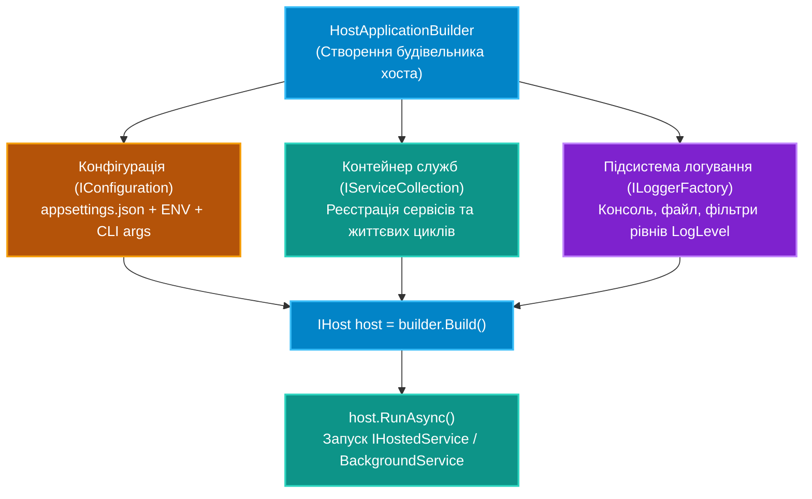

# Підмодуль 02: Сучасний хостинг застосунків, конфігурація та логування (`OOP - Generic Host Configuration and Logging.sln`)

Цей підмодуль присвячено фундаментальному стандарту сучасного .NET — **Generic Host (`Host.CreateApplicationBuilder`)**. Ця архітектурна модель дозволяє створювати високопродуктивні консольні утиліти, демони, чергові обробники та фонові мікросервіси без надлишкової прив'язки до WebHost чи ASP.NET Core, забезпечуючи уніфікований життєвий цикл, ін'єкцію залежностей, конфігураційні шари та систему структурованого аудиту.

---

## Навчальна архітектурна модель Generic Host

---

## Ключові концепції та навчальні посібники

Вся теорія, детальний розбір CLR-поведінки та практичні рекомендації систематизовані у каталозі `Docs/`:

| № | Посібник | Ключові теми та системні компоненти | Посилання на документ |
|:---:|:---|:---|:---|
| 01 | **Generic Host та Фонові служби** | Архітектура `IHost`, життєвий цикл `IHostedService`, безпечна плавна зупинка через `BackgroundService` та `CancellationToken` | [Docs/01_Generic_Host_And_Background_Services.md](Docs/01_Generic_Host_And_Background_Services.md) |
| 02 | **Конфігурація та Патерн Options** | Провайдери конфігурацій, ієрархія `appsettings.json`, типізовані `IOptions<T>`, `IOptionsSnapshot<T>`, `IOptionsMonitor<T>`, валідація параметрів | [Docs/02_Configuration_And_Options_Pattern.md](Docs/02_Configuration_And_Options_Pattern.md) |
| 03 | **Структуроване Логування та Scopes** | Абстракція `ILogger<T>`, семантичні шаблони повідомлень, рівні аудиту, фільтрація категорій, діагностичні контексти `BeginScope` | [Docs/03_Structured_Logging_And_Scopes.md](Docs/03_Structured_Logging_And_Scopes.md) |

---

## Структура проєктів рішення `OOP - Generic Host Configuration and Logging.sln`

* **`01-GenericHostLifecycleAndWorkers`**:
  * Запуск хоста через сучасний патерн `Host.CreateApplicationBuilder(args)`.
  * Демонстрація реалізації фонового обробника черги через `BackgroundService` із контрольованим завершенням (`graceful shutdown`).
  * Посилання на вихідний код: [`Program.cs`](01-GenericHostLifecycleAndWorkers/Program.cs).
* **`02-ConfigurationAndOptionsPattern`**:
  * Робота з ієрархічними налаштуваннями у файлах JSON та змінних оточення.
  * Біндинг конфігурації на POCO-класи за допомогою `builder.Services.Configure<AppOptions>(...)`.
  * Валідація конфігурації на етапі запуску за допомогою DataAnnotations (`ValidateDataAnnotations()`).
  * Посилання на вихідний код: [`Program.cs`](02-ConfigurationAndOptionsPattern/Program.cs).
* **`03-StructuredLoggingAndScopes`**:
  * Підключення консольного та файлового провайдерів логування.
  * Використання structured logging (семантичні параметри замість конкатенації рядків).
  * Трасування розподілених транзакцій та збагачення контексту за допомогою `logger.BeginScope(...)`.
  * Посилання на вихідний код: [`Program.cs`](03-StructuredLoggingAndScopes/Program.cs).
