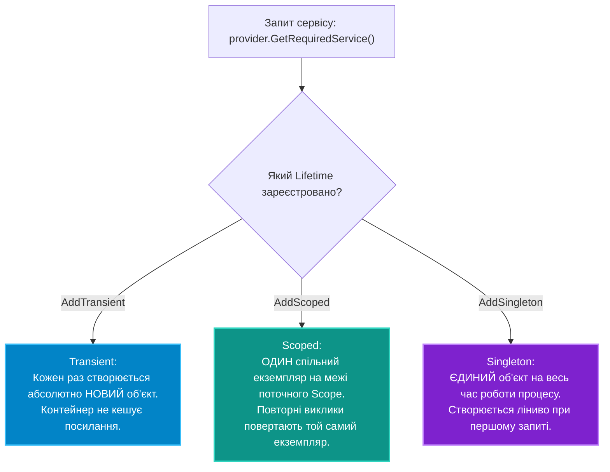

# 01. Час життя сервісів: `Transient`, `Scoped`, `Singleton`

## 1. Три моделі життєвого циклу в .NET DI

Контейнер залежностей `Microsoft.Extensions.DependencyInjection` відповідає за створення об'єктів, автоматичне задоволення їхніх залежностей через конструктор та своєчасне звільнення некерованих ресурсів (`IDisposable` / `IAsyncDisposable`).

Під час реєстрації обов'язково обирається один із трьох типів життєвого циклу (**Service Lifetime**):



---

## 2. Детальний аналіз та механіка виклику `Dispose`

Критично важливим нюансом є те, **хто саме і коли викликає `Dispose()`**:

1. **Transient (`AddTransient`)**:
   * Створюється щоразу наново.
   * **Увага:** Якщо Transient-сервіс реалізує `IDisposable`, контейнер зберігає на нього посилання, щоб викликати `Dispose()` при закритті Scope, у якому цей Transient був створений! Якщо створити мільйон Transient-об'єктів із кореневого провайдера (`Root Provider`), виникне **витік пам'яті**, оскільки кореневий контейнер ніколи не очищується до завершення програми.
2. **Scoped (`AddScoped`)**:
   * Існує рівно в межах одного блоку `using (var scope = provider.CreateScope())`.
   * При виході з блоку `scope.Dispose()` контейнер автоматично викликає `Dispose()` для всіх створених у цьому скоупі Scoped (і створених через нього Transient) сервісів у зворотному порядку створення.
3. **Singleton (`AddSingleton`)**:
   * Створюється один раз на рівні всього процесу.
   * `Dispose()` викликається лише при зупинці самого хоста або утилізації кореневого контейнера.

---

## 3. Порівняльна таблиця життєвих циклів

| Час життя | Метод реєстрації | Кількість екземплярів | Коли знищується (`Dispose`) | Типові сценарії використання |
|:---|:---|:---:|:---|:---|
| **Transient** | `services.AddTransient<T, U>()` | Кожен раз новий | При закритті батьківського Scope | Легкі сервіси без стану, утиліти, валідатори, калькулятори |
| **Scoped** | `services.AddScoped<T, U>()` | Один на Scope | При закритті поточного `IServiceScope` | `DbContext` (EF Core), сесії користувача, бізнес-сервіси замовлень |
| **Singleton** | `services.AddSingleton<T, U>()` | Один на весь процес | При повній зупинці програми | Кеші в пам'яті (`IMemoryCache`), клієнти сокетів, конфігурація |

---

## 4. Демонстрація коду: Життєвий цикл на практиці

```csharp
public interface IOperation { Guid Id { get; } }
public class OperationTransient : IOperation { public Guid Id { get; } = Guid.NewGuid(); }
public class OperationScoped : IOperation { public Guid Id { get; } = Guid.NewGuid(); }
public class OperationSingleton : IOperation { public Guid Id { get; } = Guid.NewGuid(); }

// Реєстрація:
var services = new ServiceCollection();
services.AddTransient<OperationTransient>();
services.AddScoped<OperationScoped>();
services.AddSingleton<OperationSingleton>();

var provider = services.BuildServiceProvider();

// Експеримент з областями:
using (var scope1 = provider.CreateScope())
{
    var t1 = scope1.ServiceProvider.GetRequiredService<OperationTransient>();
    var t2 = scope1.ServiceProvider.GetRequiredService<OperationTransient>();
    var s1 = scope1.ServiceProvider.GetRequiredService<OperationScoped>();
    var s2 = scope1.ServiceProvider.GetRequiredService<OperationScoped>();

    Console.WriteLine(t1.Id == t2.Id); // False (Transient завжди різний)
    Console.WriteLine(s1.Id == s2.Id); // True  (Scoped однаковий у межах scope1)
}

using (var scope2 = provider.CreateScope())
{
    var s3 = scope2.ServiceProvider.GetRequiredService<OperationScoped>();
    // s3.Id НЕ дорівнює s1.Id, оскільки це новий Scope!
}
```

---

## 5. Матриця проєкту цієї секції

| Проєкт | Посилання на вихідний код | Що демонструє під капотом |
|:---|:---|:---|
| [`01-ServiceLifetimesDemo`](../01-ServiceLifetimesDemo/Program.cs) | [Program.cs](../01-ServiceLifetimesDemo/Program.cs) | Порівняння генерації унікальних `Guid` для Transient, Scoped та Singleton служб при послідовних викликах у межах двох різних областей видимості. |
