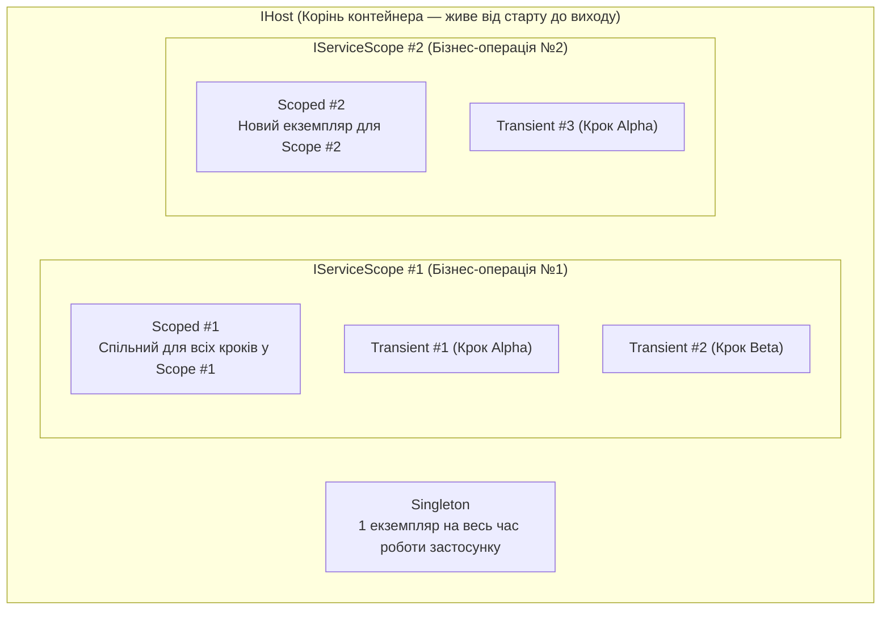

# 01. Часи життя сервісів у DI: `Transient`, `Scoped` та `Singleton`

Продовжуючи роботу з `Generic Host`, ми переходимо до серця сучасної архітектури .NET — вбудованого контейнера впровадження залежностей **`Microsoft.Extensions.DependencyInjection`**. Кожна реєстрація в `IServiceCollection` визначає **час життя (Service Lifetime)**, який диктує, коли створюються і коли знищуються екземпляри класів.

---

## 1. Три фундаментальні часи життя

### 1.1. `Transient` (`AddTransient<TService, TImplementation>()`)
- **Правило створення**: Новий екземпляр конструюється **щоразу**, коли будь-який клас у графі залежностей просить цей інтерфейс.
- **Коли використовувати**: Для легких, повністю безстанових (stateless) калькуляторів, валідаторів, маперів, які не утримують спільних ресурсів.
- **Обережно з `IDisposable`**: Якщо `Transient`-клас реалізує `IDisposable`, контейнер зобов'язаний зберігати посилання на кожен створений екземпляр до закриття поточного `IServiceScope`, щоб викликати `Dispose()`.

### 1.2. `Scoped` (`AddScoped<TService, TImplementation>()`)
- **Правило створення**: Створюється рівно **один раз на одну область видимості (`IServiceScope`)**. Усі сервіси, які беруть участь в обробці однієї бізнес-операції всередині `using IServiceScope scope = host.Services.CreateScope()`, отримають **той самий екземпляр**.
- **Коли використовувати**: Це основний час життя для контексту бази даних (`DbContext` у EF Core), репозиторіїв, `UnitOfWork` та сервісів доменної бізнес-логіки. Він гарантує, що всі кроки однієї операції працюють з однією транзакцією та одним кешем сутностей (Change Tracker), а після виходу з блоку `using` з'єднання миттєво звільняється.

### 1.3. `Singleton` (`AddSingleton<TService, TImplementation>()`)
- **Правило створення**: Створюється **один раз** при першому зверненні (або при старті) і живе до зупинки `IHost`.
- **Вимога потокобезпеки**: Оскільки до `Singleton`-об'єкта можуть одночасно звертатися різні потоки та фонові воркери, він **обов'язково має бути потокобезпечним (Thread-Safe)** (`ConcurrentDictionary`, `Interlocked`, `lock` або незмінний стан).

---

## 2. Порівняльна матриця вибору часу життя

| Критерій | `Transient` | `Scoped` | `Singleton` |
|:---|:---|:---|:---|
| **Кількість екземплярів в одному `Scope`** | Залежить від кількості споживачів ($N$) | Рівно $1$ | Рівно $1$ (спільний для всіх `Scope`) |
| **Збереження стану між операціями** | Ні | Ні (лише в межах однієї операції) | Так |
| **Вимога потокобезпеки (Thread-Safety)** | Не потрібна | Зазвичай не потрібна (1 потік на Scope) | **Обов'язкова!** |
| **Типовий представник** | `OrderValidator`, `PriceCalculator` | `StoreDbContext`, `OrderRepository` | `TelemetryQueue`, `MemoryCache` | Наочну демонстрацію зі створенням та звільненням (`Dispose`) усіх трьох типів дивіться у проєкті [`01-ServiceLifetimesDemo`](../01-ServiceLifetimesDemo/Program.cs).
