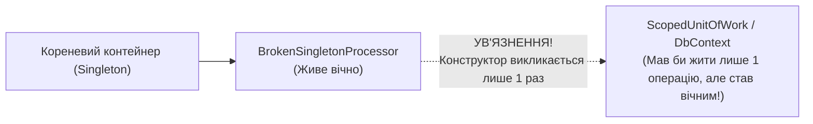

# 02. Управління областями видимості (`IServiceScopeFactory`) та пастка Captive Dependency

Робота з `Scoped`-сервісами у консольних застосунках та фонових воркерах (`BackgroundService`) вимагає чіткого розуміння того, хто і коли створює межі області видимості (`IServiceScope`). Найнебезпечніша архітектурна помилка при роботі з DI відома як **Captive Dependency («Ув'язнена залежність»)**.

---

## 1. Суть пастки Captive Dependency

Правило ієрархії часів життя у DI звучить категорично:
> [!CAUTION]
> **Сервіс ніколи не повинен напряму залежати від іншого сервісу з коротшим часом життя!**
> - `Singleton`  може напряму інжектувати лише `Singleton`.
> - `Scoped`  може інжектувати `Scoped` та `Singleton`.

Що трапиться, якщо `Singleton`-координатор (або `BackgroundService`, який сам реєструється як `Singleton`) попросить у своєму конструкторі `Scoped`-залежність (наприклад, `StoreDbContext` чи `ScopedUnitOfWork`)?



### Наслідки ув'язнення `Scoped`-сервісу всередині `Singleton`:
1. **Витік пам'яті та деградація EF Core**: `DbContext` ніколи не викликає `Dispose()`, його `ChangeTracker` нескінченно накопичує тисячі закешованих об'єктів у пам'яті.
2. **Застарілі дані (Stale State)**: контекст повертає старі закешовані записи замість актуальних даних із SQLite/SQL-бази.
3. **Краш при багатопотоковому доступі**: `DbContext` не підтримує паралельних викликів з кількох потоків.

---

## 2. Автоматичне виявлення помилки (`ValidateScopes` та `ValidateOnBuild`)

У `Generic Host` у середовищі `Development` (або при явному налаштуванні `ServiceProviderOptions`) вмикаються два потужні запобіжники:
- **`ValidateScopes = true`** — забороняє створювати `Scoped`-сервіси з кореневого контейнера `host.Services`.
- **`ValidateOnBuild = true`** — перевіряє весь граф конструкторів усіх зареєстрованих сервісів ще в момент виклику `builder.Build()`, миттєво викидаючи `InvalidOperationException: Cannot consume scoped service '...' from singleton '...'`.

---

## 3. Еталонне виправлення через `IServiceScopeFactory`

Як же фоновій службі (`BackgroundService`) або `Singleton`-сервісу легально звернутися до бази даних чи `Scoped`-репозиторію?

Замість самої `Scoped`-залежності у конструктор інжектується фабрика областей видимості — **`IServiceScopeFactory`** (яка сама є безпечним `Singleton`-інфраструктурним сервісом):

```csharp
public sealed class SafeBatchCoordinator
{
    private readonly IServiceScopeFactory _scopeFactory;

    public SafeBatchCoordinator(IServiceScopeFactory scopeFactory)
    {
        _scopeFactory = scopeFactory;
    }

    public async Task ProcessJobAsync(string jobName)
    {
        // На кожну окрему задачу відкриваємо свіжий ізольований Scope!
        await using AsyncServiceScope scope = _scopeFactory.CreateAsyncScope();

        var unitOfWork = scope.ServiceProvider.GetRequiredService<ScopedUnitOfWork>();
        await unitOfWork.SaveBatchAsync(jobName);
    } // <-- Тут Scope автоматично закривається і викликає DisposeAsync/Dispose!
}
```

Практичну демонстрацію перехоплення `Captive Dependency` та еталонного виправлення через `IServiceScopeFactory` дивіться у проєкті [`02-ScopesAndCaptiveDependency`](../02-ScopesAndCaptiveDependency/Program.cs).
