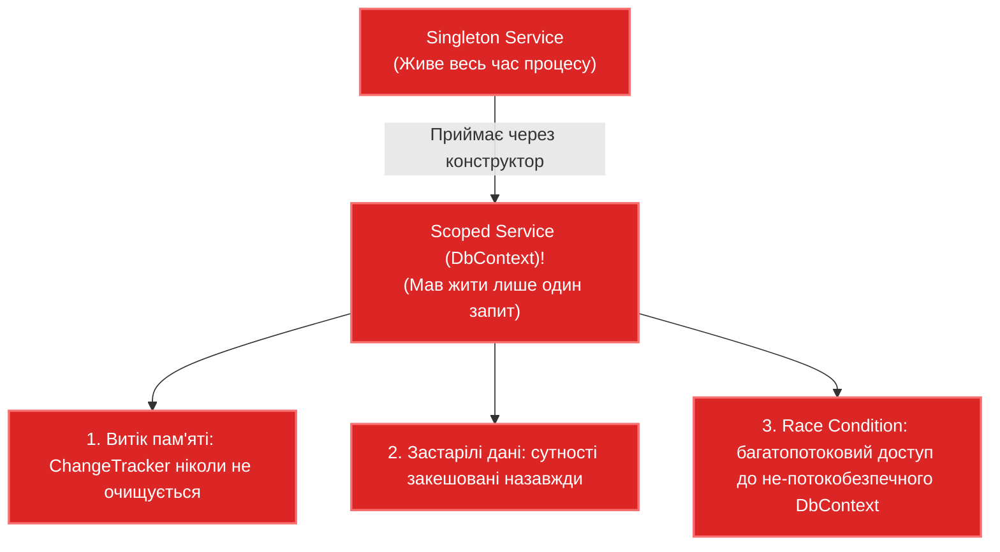

# 02. Управління областями (`IServiceScopeFactory`) та пастка `Captive Dependency`

## 1. Що таке Captive Dependency (Захоплена залежність)?

**Captive Dependency** — це одна з найнебезпечніших архітектурних помилок у .NET-застосунках. Вона виникає тоді, коли довгоживучий сервіс (наприклад, **`Singleton`**) приймає у свій конструктор залежність із коротшим часом життя (наприклад, **`Scoped`**).

Оскільки Singleton створюється лише один раз і живе протягом усього життя застосунку, переданий йому в конструктор Scoped-об'єкт стає його "бранцем" (captive) і ніколи не знищується.



---

## 2. Як вбудований валідатор контейнера виявляє Captive Dependency

У режимі розробки сучасний .NET Generic Host автоматично вмикає дві критичні перевірки при побудові провайдера:
* **`ValidateScopes = true`** — забороняє резолвити Scoped-сервіси безпосередньо з кореневого контейнера (`Root Provider`).
* **`ValidateOnBuild = true`** — перевіряє граф залежностей уже на етапі запуску програми і викидає виняток `InvalidOperationException`:

```
Cannot consume scoped service 'StoreDbContext' from singleton 'BackgroundWorker'.
```

---

## 3. Порівняння: Помилкова конфігурація проти `IServiceScopeFactory`

### Антипатерн: Пряме захоплення у конструкторі

```csharp
// ПОГАНО: Помилка Captive Dependency
public class BadBackgroundWorker : BackgroundService
{
    private readonly StoreDbContext _dbContext; // ПОМИЛКА: Scoped у Singleton!

    public BadBackgroundWorker(StoreDbContext dbContext)
    {
        _dbContext = dbContext;
    }

    protected override async Task ExecuteAsync(CancellationToken stoppingToken)
    {
        while (!stoppingToken.IsCancellationRequested)
        {
            // Непотокобезпечний паралельний доступ до одного й того самого DbContext!
            var count = await _dbContext.Orders.CountAsync(stoppingToken);
            await Task.Delay(5000, stoppingToken);
        }
    }
}
```

### Рекомендоване рішення: Створення динамічної області через `IServiceScopeFactory`

```csharp
// ДОБРЕ: Singleton ін'єктує фабрику скоупів та створює ізольовану область на кожну операцію
public class GoodBackgroundWorker : BackgroundService
{
    private readonly IServiceScopeFactory _scopeFactory;
    private readonly ILogger<GoodBackgroundWorker> _logger;

    public GoodBackgroundWorker(IServiceScopeFactory scopeFactory, ILogger<GoodBackgroundWorker> logger)
    {
        _scopeFactory = scopeFactory;
        _logger = logger;
    }

    protected override async Task ExecuteAsync(CancellationToken stoppingToken)
    {
        while (!stoppingToken.IsCancellationRequested)
        {
            // Створюємо ізольовану область на кожну ітерацію:
            using (IServiceScope scope = _scopeFactory.CreateScope())
            {
                var dbContext = scope.ServiceProvider.GetRequiredService<StoreDbContext>();
                
                var pendingOrders = await dbContext.Orders
                    .Where(o => !o.IsProcessed)
                    .ToListAsync(stoppingToken);

                // Безпечна обробка...
            } // ТУТ DbContext гарантовано викликає Dispose() та очищає ChangeTracker!

            await Task.Delay(5000, stoppingToken);
        }
    }
}
```

---

## 4. Матриця сумісності життєвих циклів

| Сервіс-споживач (Залежить від) | Може безпечно ін'єктувати `Transient` | Може безпечно ін'єктувати `Scoped` | Може безпечно ін'єктувати `Singleton` |
|:---|:---:|:---:|:---:|
| **Transient** | Так | Тільки якщо сам створюється всередині Scope | Так |
| **Scoped** | Так | Так (обидва живуть у межах одного Scope) | Так |
| **Singleton** | Так (якщо Transient без стану) | **НІ! Заборонено (Captive Dependency)** | Так |

---

## 5. Матриця проєкту цієї секції

| Проєкт | Посилання на вихідний код | Що демонструє під капотом |
|:---|:---|:---|
| [`02-ScopesAndCaptiveDependency`](../02-ScopesAndCaptiveDependency/Program.cs) | [Program.cs](../02-ScopesAndCaptiveDependency/Program.cs) | Демонстрація виявлення Captive Dependency за допомогою `ValidateScopes = true` та безпечна робота через `IServiceScopeFactory`. |
