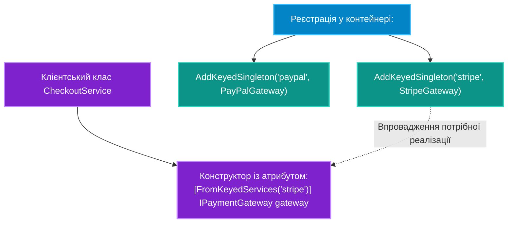

# 03. Множинні реалізації та Keyed Services (.NET 8/9)

## 1. Проблема вибору реалізації одного інтерфейсу

У складних корпоративних застосунках один інтерфейс часто має декілька конкретних реалізацій:
* `INotificationService` -> `EmailNotificationService`, `SmsNotificationService`, `TelegramNotificationService`
* `IPaymentGateway` -> `StripePaymentGateway`, `PayPalPaymentGateway`, `LiqPayPaymentGateway`

До виходу .NET 8 вибір між ними вимагав створення громіздких фабрик на базі делегатів `Func<string, IPaymentGateway>` або використання сторонніх IoC-контейнерів (Autofac).

Починаючи з .NET 8, стандартний контейнер надає першокласну підтримку **Keyed Services**.

---

## 2. Архітектура реєстрації та резолву за ключем



---

## 3. Порівняння: `IEnumerable<T>` проти Keyed Services

### Підхід 1: Ін'єкція списку `IEnumerable<T>` (Патерн Стратегія / Chain of Responsibility)
Корисно, коли операцію потрібно виконати **всіма** зареєстрованими обробниками:

```csharp
public class NotificationManager
{
    private readonly IEnumerable<INotificationService> _senders;

    public NotificationManager(IEnumerable<INotificationService> senders)
    {
        _senders = senders; // Контейнер автоматично передасть УСІ зареєстровані реалізації
    }

    public async Task BroadcastAsync(string message)
    {
        foreach (var sender in _senders)
        {
            await sender.SendAsync(message);
        }
    }
}
```

### Підхід 2: Сучасні Keyed Services (.NET 8+)
Корисно, коли потрібна **конкретна** реалізація за бізнес-ідентифікатором або конфігурацією:

```csharp
// Реєстрація:
builder.Services.AddKeyedScoped<IPaymentGateway, StripePaymentGateway>("stripe");
builder.Services.AddKeyedScoped<IPaymentGateway, PayPalPaymentGateway>("paypal");

// Споживання через атрибут [FromKeyedServices]:
public class OrderCheckoutHandler
{
    private readonly IPaymentGateway _paymentGateway;

    public OrderCheckoutHandler([FromKeyedServices("stripe")] IPaymentGateway paymentGateway)
    {
        _paymentGateway = paymentGateway;
    }

    public async Task CheckoutAsync(decimal amount) => await _paymentGateway.ProcessPaymentAsync(amount);
}

// Динамічний резолв за ключем під час виконання:
var gateway = serviceProvider.GetRequiredKeyedService<IPaymentGateway>("paypal");
```

---

## 4. Порівняльна таблиця стратегій вибору залежності

| Метод | Як реєструється | Як ін'єктується | Переваги | Обмеження |
|:---|:---|:---|:---|:---|
| **Остання реєстрація (Last-in)** | `AddTransient<I, A>()`<br/>`AddTransient<I, B>()` | `public C(I service)` | Простота | Сервіс `B` безмовно заміщує `A` при звичайній ін'єкції одного `I` |
| **Колекція `IEnumerable<T>`** | Багаторазовий `AddTransient` | `public C(IEnumerable<I> list)` | Ідеально для плагінів, правил валідації, пайплайнів | Необхідно вручну фільтрувати потрібний сервіс через LINQ |
| **Keyed Services (.NET 8+)** | `AddKeyedTransient<I, A>("key")` | `[FromKeyedServices("key")]` або `GetKeyedService` | Висока продуктивність, чистий та зрозумілий синтаксис | Потребує .NET 8 або новіших версій |

---

## 5. Матриця проєкту цієї секції

| Проєкт | Посилання на вихідний код | Що демонструє під капотом |
|:---|:---|:---|
| [`03-MultipleAndKeyedServices`](../03-MultipleAndKeyedServices/Program.cs) | [Program.cs](../03-MultipleAndKeyedServices/Program.cs) | Реєстрація кількох обробників одного інтерфейсу, ін'єкція `IEnumerable<T>` та робота з `[FromKeyedServices]`. |
