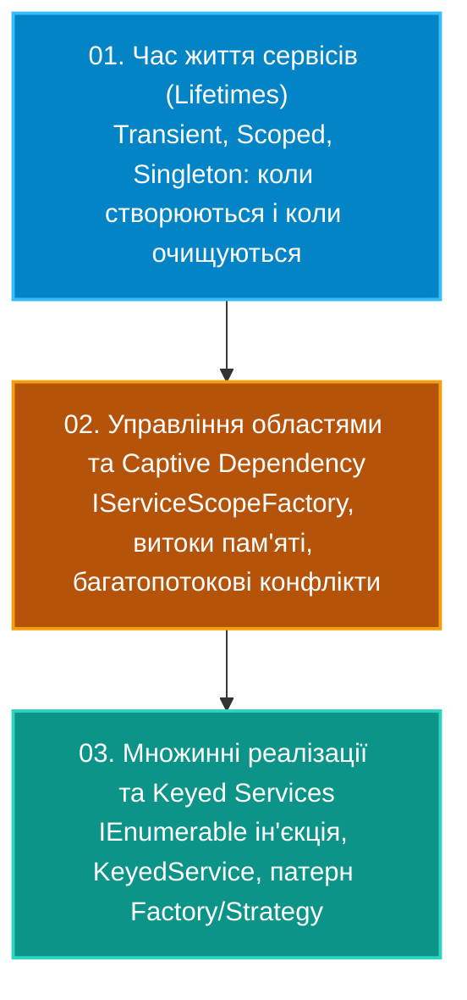

# Підмодуль 03: Впровадження залежностей у .NET (`OOP - Dependency Injection.sln`)

Цей підмодуль є фундаментальним для розуміння архітектури сучасних систем на базі .NET. Тут розглядаються внутрішні механізми офіційного контейнера інверсії керування (`Microsoft.Extensions.DependencyInjection`), правила проектування життєвих циклів компонентів, виявлення прихованих пасток безпеки багатопотоковості та робота з сучасними можливостями C# 12+ (.NET 8/9 Keyed Services).

---

## Архітектурна дорожня карта підмодуля

---

## Навігація по навчальних матеріалах (`Docs`)

| № | Посібник | Ключові теми та системні інструменти | Посилання на документ |
|:---:|:---|:---|:---|
| 01 | **Час життя сервісів: Transient, Scoped, Singleton** | Життєвий цикл сервісів, виклик `Dispose`, поведінка кореневого та дочірніх контейнерів | [Docs/01_Service_Lifetimes_Transient_Scoped_Singleton.md](Docs/01_Service_Lifetimes_Transient_Scoped_Singleton.md) |
| 02 | **Області видимості та Captive Dependency** | Небезпека захоплення Scoped сервісу через Singleton, робота з `IServiceScopeFactory`, валідація областей | [Docs/02_IServiceScopeFactory_And_Captive_Dependency.md](Docs/02_IServiceScopeFactory_And_Captive_Dependency.md) |
| 03 | **Множинні реалізації та Keyed Services** | Реєстрація декількох класів за одним інтерфейсом, вибірка за ключем через атрибут `[FromKeyedServices]`, патерн Стратегія | [Docs/03_Multiple_Implementations_And_Keyed_Services.md](Docs/03_Multiple_Implementations_And_Keyed_Services.md) |

---

## Структура проєктів рішення `OOP - Dependency Injection.sln`

* **`01-ServiceLifetimesDemo`**:
  * Порівняння трьох стратегій життєвого циклу за допомогою сервісів із унікальними ідентифікаторами (`Guid`).
  * Демонстрація поведінки сервісів у двох послідовних областях видимості (`IServiceScope`).
  * Посилання на вихідний код: [`Program.cs`](01-ServiceLifetimesDemo/Program.cs).
* **`02-ScopesAndCaptiveDependency`**:
  * Реалізація фонової служби, якій потрібен доступ до Scoped-ресурсу (наприклад, контексту бази даних).
  * Демонстрація помилки `InvalidOperationException` при ввімкненій опції `ValidateScopes = true`.
  * Виправлення через створення динамічних областей за допомогою `IServiceScopeFactory`.
  * Посилання на вихідний код: [`Program.cs`](02-ScopesAndCaptiveDependency/Program.cs).
* **`03-MultipleAndKeyedServices`**:
  * Реєстрація декількох платіжних систем або провайдерів сповіщень під одним інтерфейсом `INotificationService`.
  * Ін'єкція колекції `IEnumerable<T>`.
  * Використання новітнього механизму .NET 8/9 — `AddKeyedSingleton<TService>("key")` та атрибута `[FromKeyedServices("key")]`.
  * Посилання на вихідний код: [`Program.cs`](03-MultipleAndKeyedServices/Program.cs).
