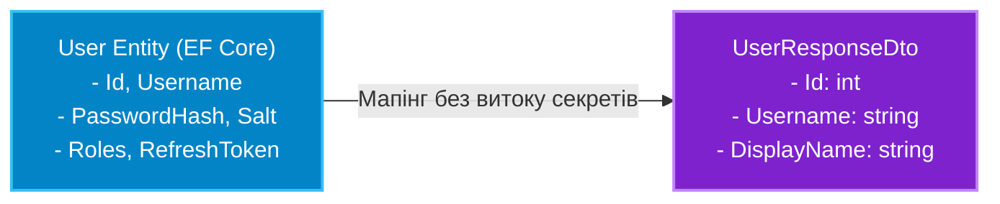

# 01. Патерн DTO (Data Transfer Object) та Об'єктний Мапінг

## 1. Навіщо потрібен DTO? Проблема розкриття сутностей бази даних

У наївних архітектурах сутності ORM (наприклад, `User` або `Account`) повертаються безпосередньо у відповідь на запити користувача або приймаються від нього у форму введення. Це призводить до трьох критичних проблем:

1. **Витік конфіденційних даних (Data Exposure)**: Сутність бази даних містить службові поля: `PasswordHash`, `SecurityStamp`, `InternalNotes`. Випадкове повернення всієї сутності передає ці дані клієнту.
2. **Атака Over-Posting (Mass Assignment)**: Коли клієнт передає JSON, де поряд із дозволеними полями змінює `IsAdmin: true` або `Balance: 999999`, наївний ORM збереже ці значення в таблицю.
3. **Циклічні посилання та Cartesian Overhead**: Навігаційні властивості EF Core (`Order.Customer.Orders...`) ламають серіалізатор через рекурсивні зациклення або роздувають розмір мережевого трафіку.

**Data Transfer Object (DTO)** — це чистий клас або рекорд без бізнес-поведінки, який містить лише ті дані, які необхідні для конкретної операції обміну:



---

## 2. Порівняння: Ручний мапінг проти AutoMapper

### Варіант 1: Ручний мапінг (Pure C# Extension Methods)
* **Плюси:** Абсолютна швидкість виконання (нульовий оверхед), повний контроль компілятора над кожним полем, легкий рефакторинг та підтримка Native AOT.
* **Мінуси:** Багатослівність ("boilertemplate") при великій кількості моделей з 20+ властивостями.

```csharp
public static class UserMappingExtensions
{
    public static UserResponseDto ToDto(this User user) => new(
        user.Id,
        user.Username,
        $"{user.FirstName} {user.LastName}",
        user.Orders.Count
    );
}
```

### Варіант 2: Бібліотека AutoMapper
* **Плюси:** Декларативний опис правил, авто-мапінг за збігом імен, автоматичне сплющення ієрархій (`Customer.Address.City` -> `CustomerAddressCity`).
* **Мінуси:** Невеликий оверхед під час запуску (побудова дерев виразів), необхідність валідації тестів конфігурації.

---

## 3. Проєктування DTO на базі `record` у сучасному C#

У C# 9-12 ідеальним синтаксисом для DTO є позиційні записи (**`record`**):
* Незмінність (`immutability`) за замовчуванням завдяки `init`-only властивостям.
* Вбудоване структурне порівняння за значеннями полів (`Value Equality`).
* Лаконічний однорядковий синтаксис:

```csharp
public record CreateUserRequestDto(
    [Required] string Username,
    [EmailAddress] string Email,
    [MinLength(8)] string Password
);

public record UserSummaryResponseDto(
    int Id,
    string Username,
    string FullName,
    DateTime RegisteredAt
);
```

---

## 4. Порівняльна таблиця підходів до трансформації об'єктів

| Критерій | Ручний мапінг (`Select` / Extension) | Генератори коду (Mapperly, Riok) | AutoMapper |
|:---|:---|:---|:---|
| **Швидкість роботи** | Максимальна (нативна) | Максимальна (згенерований код) | Дуже висока (компіляція Expression Trees) |
| **Перевірка компілятором** | 100% під час збірки проєкту | 100% під час збірки проєкту | Під час виконання (`AssertConfigurationIsValid`) |
| **Підтримка Native AOT** | Повна | Повна | Обмежена (використовує динамічну генерацію) |
| **Зручність при 50+ класах** | Велика кількість ручного коду | Декларативна, нуль рутини | Декларативна, автоконвенції |

---

## 5. Матриця проєкту цієї секції

| Проєкт | Посилання на вихідний код | Що демонструє під капотом |
|:---|:---|:---|
| [`AutoMapperDemo`](../AutoMapperDemo/Program.cs) | [Program.cs](../AutoMapperDemo/Program.cs) | Базове налаштування AutoMapper, створення мапінгу між доменними моделями та DTO, тестування валідності профілів. |
