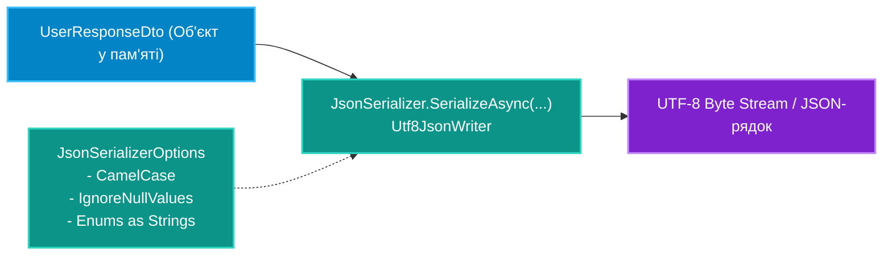

# 03. Шаблони Серіалізації JSON та XML у взаємодії з DTO

## 1. Серіалізація як частина DTO-контракту

Після того, як доменна сутність трансформувалася у DTO, настає етап серіалізації для передачі через мережеві сокети або збереження на диску. Основним високопродуктивним рушієм серіалізації в .NET є простір імен **`System.Text.Json`**.



---

## 2. Оптимальна конфігурація `JsonSerializerOptions`

За замовчуванням `JsonSerializer` використовує правила PascalCase (властиві C#), тоді як веб-клієнти очікують camelCase.

```csharp
var options = new JsonSerializerOptions
{
    PropertyNamingPolicy = JsonNamingPolicy.CamelCase, // Name -> name
    WriteIndented = false, // Вимикаємо відступи для економії байтів у мережі
    DefaultIgnoreCondition = JsonIgnoreCondition.WhenWritingNull, // Не передаємо null-поля
    Converters =
    {
        new JsonStringEnumConverter(JsonNamingPolicy.CamelCase) // Enums як рядки замість чисел
    }
};
```

---

## 3. Тонке налаштування серіалізації через атрибути

Коли поведінку окремого поля потрібно змінити без глобального переналаштування опцій, застосовуються декларативні атрибути:

```csharp
public class OrderDto
{
    [JsonPropertyName("order_identifier")] // Кастомне ім'я поля в JSON
    public Guid Id { get; set; }

    [JsonIgnore] // Поле ніколи не потрапить у вихідний JSON
    public string InternalSignature { get; set; } = string.Empty;

    [JsonNumberHandling(JsonNumberHandling.AllowReadingFromString)] // Дозволяє прочитати "42" як число
    public int Quantity { get; set; }
}
```

---

## 4. Порівняння: `System.Text.Json` проти застарілого `Newtonsoft.Json`

| Характеристика | `System.Text.Json` (Вбудований у .NET) | `Newtonsoft.Json` (Json.NET) |
|:---|:---|:---|
| **Продуктивність** | Вкрай висока (робота з `ReadOnlySpan<byte>` та `Utf8JsonReader`) | Помітно нижча через додаткові алокації рядків |
| **Виділення пам'яті (Allocations)** | Мінімальне (майже zero-allocation при роботі зі стрімами) | Значне створення проміжних об'єктів `JObject` |
| **Native AOT сумісність** | Повна підтримка через `[JsonSerializable]` Source Generator | Не сумісний з AOT через інтенсивне використання Reflection |
| **Гнучкість у нестандартних випадках** | Висока, але суворіша | Дуже висока, пробачає синтаксичні відхилення |

---

## 5. Матриця проєкту цієї секції

| Проєкт | Посилання на вихідний код | Що демонструє під капотом |
|:---|:---|:---|
| [`SerializationDemo`](../SerializationDemo/Program.cs) | [Program.cs](../SerializationDemo/Program.cs) | Серіалізація та десеріалізація DTO-моделей у формат JSON, налаштування політик імен та використання кастомних конвертерів. |
