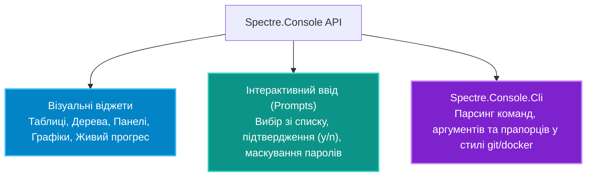

# Підмодуль 05: Побудова професійних інтерфейсів CLI через Spectre.Console (`OOP - CLI and Spectre Console.sln`)

Цей підмодуль демонструє можливості перетворення класичної чорно-білої консолі Windows/Linux на сучасний повноцінний термінальний інтерфейс користувача (TUI). Бібліотека **Spectre.Console** дозволяє створювати насичені віджети, інтерактивні опитування, адаптивні таблиці, графіки та деревоподібні структури без прямого низькорівневого виклику системних API Win32 або ANSI-escape послідовностей.

---

## Можливості Spectre.Console

---

## Навігація по навчальних посібниках (`Docs`)

| № | Посібник | Ключові теми та системні інструменти | Посилання на документ |
|:---|:---|:---|:---|
| 01 | **Основи Spectre.Console та Розмітка** | BBCode-стиль розмітки `[bold green]...[/]`, панелі, відступи, підтримка кольорів TrueColor | [Docs/01_Spectre_Console_Basics_And_Markup.md](Docs/01_Spectre_Console_Basics_And_Markup.md) |
| 02 | **Інтерактивні Елементи та Віджети** | Діалоги вибору `SelectionPrompt`, рядки стану `Status`, прогрес-бари `Progress`, таблиці | [Docs/02_Interactive_Prompts_And_Widgets.md](Docs/02_Interactive_Prompts_And_Widgets.md) |
| 03 | **Архітектура CLI-команд** | Побудова команд за патерном Command, ін'єкція залежностей у CLI-команди, валідація налаштувань | [Docs/03_CLI_Commands_And_Architecture.md](Docs/03_CLI_Commands_And_Architecture.md) |

---

## Каталог демонстраційних проєктів

Рішення містить багату колекцію вузькоспеціалізованих проєктів для кожного віджета:
* **`Console/Showcase`**: Комплексна галерея всіх візуальних елементів бібліотеки. Посилання: [`Program.cs`](Console/Showcase/Program.cs).
* **`Console/Tables`**: Побудова реляційних таблиць з автоформатуванням ширини колонок. Посилання: [`Program.cs`](Console/Tables/Program.cs).
* **`Console/Prompt`**: Інтерактивні меню зі стрілочною навігацією для вибору пункту меню. Посилання: [`Program.cs`](Console/Prompt/Program.cs).
* **`Console/Progress` та `Status`**: Асинхронні спінери та багатопотокові прогрес-бари фонових завдань.
