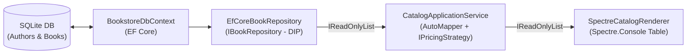

# 01. Інтеграція EF Core, SOLID, AutoMapper, DI та Spectre.Console

## 1. Потік даних через шари архітектури

У реальних комерційних проєктах база даних ніколи не викликається напряму з консольного меню чи контролера. Замість цього запит проходить через чітко ізольовані шари:

---

## 2. Як кожен принцип SOLID працює у цьому прикладі

| Принцип | Як реалізовано у проєкті | Файл у коді |
|:---|:---|:---|
| **SRP** | Доступ до БД (`EfCoreBookRepository`), бізнес-логіка (`CatalogApplicationService`) та рендеринг таблиці (`SpectreCatalogRenderer`) рознесені по окремих класах | [CatalogServiceAndUi.cs](../EFCoreCleanArchitectureDemo/Presentation/CatalogServiceAndUi.cs#L13) |
| **OCP** | Розрахунок знижки винесено в інтерфейс `IPricingStrategy` (`AcademicDiscountPricingStrategy`) | [ContractsAndMapping.cs](../EFCoreCleanArchitectureDemo/Application/ContractsAndMapping.cs#L39) |
| **DIP** | Сервіс каталогу залежить від абстракції `IBookRepository`, а не від `BookstoreDbContext` | [BookstoreDataAccess.cs](../EFCoreCleanArchitectureDemo/Infrastructure/BookstoreDataAccess.cs#L43) |
