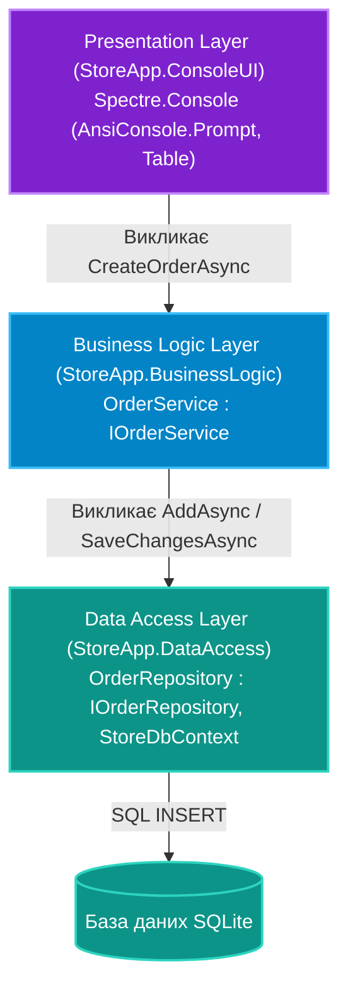

# 01. Трирівнева Архітектура: Від Entity Framework Core до Spectre.Console

## 1. Класична трирівнева архітектура (3-Tier Architecture)

Головний принцип трирівневої архітектури — **односпрямована залежність** та **розділення відповідальностей (Separation of Concerns)**:
1. **Шар даних (Data Access Layer - DAL)** знає виключно про базу даних, таблиці, ключі та ORM (EF Core). Він не знає, як дані будуть відображатися на екрані.
2. **Шар бізнес-логіки (Business Logic Layer - BLL)** інкапсулює правила предметної області: як розраховується знижка, чи дозволено змінювати статус замовлення, які повідомлення генерувати. Він залежить лише від контрактів репозиторіїв.
3. **Шар представлення (Presentation Layer - UI)** відповідає за взаємодію з людиною: рендеринг меню через Spectre.Console, зчитування вибору клавіатури, відображення помилок. Він звертається виключно до сервісів BLL і ніколи напряму не підключає `DbContext`.



---

## 2. Порушення архітектури (Антипатерн) проти Чистого підходу

### Антипатерн "Розумний UI" (Smart UI)
```csharp
// ПОГАНО: Пряме звернення до БД всередині коду консольного меню!
public class BadConsoleMenu
{
    public void DisplayOrders()
    {
        using var db = new StoreDbContext(); // ПОМИЛКА: UI знає про підключення до БД!
        var orders = db.Orders.ToList();
        
        foreach(var o in orders)
            Console.WriteLine(o.Id);
    }
}
```

### Рекомендована реалізація: Взаємодія через сервісний контракт
```csharp
// 1. DAL: Репозиторій ізолює EF Core
public class OrderRepository : IOrderRepository
{
    private readonly StoreDbContext _context;
    public OrderRepository(StoreDbContext context) => _context = context;

    public async Task<List<Order>> GetAllWithDetailsAsync() =>
        await _context.Orders.Include(o => o.Customer).Include(o => o.Items).ToListAsync();
}

// 2. BLL: Бізнес-сервіс розраховує правила та повертає DTO
public class OrderService : IOrderService
{
    private readonly IOrderRepository _repository;
    public OrderService(IOrderRepository repository) => _repository = repository;

    public async Task<List<OrderSummaryDto>> GetOrdersSummaryAsync()
    {
        var orders = await _repository.GetAllWithDetailsAsync();
        return orders.Select(o => new OrderSummaryDto(o.Id, o.Customer.Name, o.CalculateTotal())).ToList();
    }
}

// 3. UI: Spectre.Console відображає підготовлені DTO
public class OrderConsoleView
{
    private readonly IOrderService _orderService;
    public OrderConsoleView(IOrderService orderService) => _orderService = orderService;

    public async Task RenderAsync()
    {
        var summaries = await _orderService.GetOrdersSummaryAsync();
        
        var table = new Table().Border(TableBorder.Rounded);
        table.AddColumn("[bold]Номер[/]");
        table.AddColumn("[bold]Клієнт[/]");
        table.AddColumn("[bold]Сума[/]");

        foreach (var item in summaries)
        {
            table.AddRow(item.Id.ToString(), item.CustomerName, $"[green]{item.TotalAmount:C}[/]");
        }

        AnsiConsole.Write(table);
    }
}
```

---

## 3. Матриця відповідальності компонентів

| Компонент | Шар | Що дозволено | Чого категорично НЕ повинно бути |
|:---|:---:|:---|:---|
| **`StoreDbContext`** | DAL | Опис схеми БД, конфігурація зв'язків | Викликів `Console.Write` або бізнес-валідації цін |
| **`OrderRepository`** | DAL | CRUD-операції, LINQ-запити, збереження | Логіки інтерфейсу користувача |
| **`OrderService`** | BLL | Розрахунок знижок, транзакційні правила | Прямих SQL-запитів, посилань на Spectre.Console |
| **`ConsoleApp`** | UI | Рендеринг кольорів, таблиць, зчитування меню | Прямого створення екземплярів `DbContext` через `new` |

---

## 4. Матриця проєктів цієї секції

| Проєкт | Посилання на вихідний код | Що демонструє під капотом |
|:---|:---|:---|
| [`StoreApp.DataAccess`](../StoreApp.DataAccess/Repositories/StoreRepositories.cs) | [StoreRepositories.cs](../StoreApp.DataAccess/Repositories/StoreRepositories.cs) | Інкапсуляція роботи з `StoreDbContext`, підвантаження залежних таблиць через `Include`. |
| [`StoreApp.BusinessLogic`](../StoreApp.BusinessLogic/Services/StoreBusinessServices.cs) | [StoreBusinessServices.cs](../StoreApp.BusinessLogic/Services/StoreBusinessServices.cs) | Реалізація бізнес-правил підтвердження замовлень та мапінг сутностей у DTO. |
| [`StoreApp.ConsoleUI`](../StoreApp.ConsoleUI/Program.cs) | [Program.cs](../StoreApp.ConsoleUI/Program.cs) | Головний цикл інтерактивного меню з використанням таблиць і запитів Spectre.Console. |
