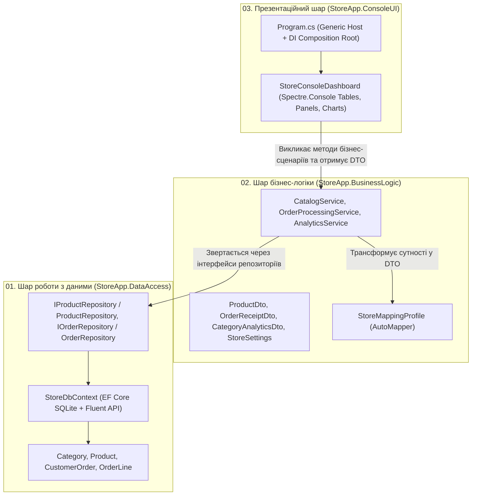

# Тришарова архітектура застосунку: EF Core (SQLite) + Business Logic (DTO, AutoMapper) + Spectre.Console

Цей підсумковий інтеграційний проєкт поєднує в єдиній системі всі ключові технології, розглянуті у курсі:
- **Глава 07**: `Entity Framework Core (SQLite)`, конфігурація `Fluent API`, `AsNoTracking()`, жадібне завантаження `Include()` та транзакції.
- **Глава 08 (Підмодулі 01–05)**: принципи `SOLID`, `Generic Host`, `IConfiguration` + `IOptions<T>`, структуроване логування `ILogger<T>`, контейнер `Dependency Injection`, трансформація через `AutoMapper` (`DTO`) та багатий термінальний інтерфейс `Spectre.Console`.

---

## 1. Декомпозиція на три фізичні шари (3-Tier Architecture)

Замість розміщення всього коду в одному монолітному проєкті, система фізично розділена на три окремі збірки (`.csproj`), кожна з яких має чітко окреслену зону відповідальності:

---

## 2. Детальний розбір кожного шару

### Шар 1: `StoreApp.DataAccess` (Data Access Layer)
Відповідає виключно за збереження та вибірку даних із реляційної бази SQLite:
- **`StoreDbContext`**: налаштовує таблиці `Categories`, `Products`, `CustomerOrders`, `OrderLines`, унікальні індекси на `Sku` та `OrderNumber`, а також точність грошових полів `HasPrecision(18, 2)`.
- **`ProductRepository`**: використовує `.AsNoTracking().Include(p => p.Category)` для швидкого читання каталогу без накладних витрат Change Tracker, і окремі Tracked-методи для модифікації залишків.
- **`OrderRepository`**: виконує атомарне списання складських залишків та створення замовлення всередині явної транзакції `BeginTransactionAsync()` / `CommitAsync()`.

### Шар 2: `StoreApp.BusinessLogic` (Business Logic Layer)
Містить правила предметної області (Domain Rules) та ізолює презентаційний шар від деталей бази даних:
- **Моделі DTO (`ProductDto`, `OrderReceiptDto`, `CategoryAnalyticsDto`)**: плоскі моделі передачі даних, які не містять циклічних навігаційних властивостей EF Core.
- **`StoreMappingProfile` (`AutoMapper`)**: автоматично сплющує граф `Product -> Category.Name` у поле `ProductDto.CategoryName`.
- **`CatalogService` та `OrderProcessingService`**: перевіряють бізнес-інваріанти (наявність товару на складі, розрахунок VIP-знижки згідно з `IOptions<StoreSettings>`) та записують структуровані події через `ILogger<T>`.
- **`AnalyticsService`**: агрегує виторг та вартість складських запасів у розрізі категорій.

### Шар 3: `StoreApp.ConsoleUI` (Presentation Layer & Composition Root)
Виконує дві ролі:
1. **Корінь компонування (`Composition Root`)**: конфігурує `Host.CreateApplicationBuilder`, читає `appsettings.json`, валідує `StoreSettings` при старті (`ValidateOnStart()`), реєструє `StoreDbContext`, репозиторії, сервіси та `AutoMapper` у контейнері DI.
2. **Термінальний інтерфейс (`StoreConsoleDashboard`)**: візуалізує отримані DTO за допомогою віджетів `Spectre.Console` (`Table`, `Panel`, `Rule`, `BarChart`, `BreakdownChart`).
