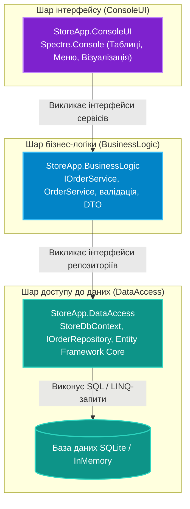

# Підмодуль 06: Трирівнева архітектура із Spectre.Console та EF Core (`OOP - SpectreConsole EFCore Tiered App.sln`)

Цей підмодуль є фінальним інтеграційним проектом розділу архітектури. Він демонструє, як об'єднати на практиці всі розглянуті технології:
1. **DataAccess Layer** — робота з базою даних через Entity Framework Core, контекст даних, репозиторії.
2. **BusinessLogic Layer** — ізольовані доменні сервіси, бізнес-правила, валідація замовлень.
3. **ConsoleUI Layer** — інтерактивний графічний консольний інтерфейс користувача на базі Spectre.Console.

---

## Трирівнева архітектурна модель

---

## Навігація по навчальних посібниках (`Docs`)

| № | Посібник | Ключові теми та системні інструменти | Посилання на документ |
|:---:|:---|:---|:---|
| 01 | **Трирівнева Архітектура: Spectre.Console + EF Core** | Правила розбиття коду на збірки, ізоляція шарів, патерн Repository та чистий UI | [Docs/01_Three_Tier_Architecture_EFCore_And_SpectreConsole.md](Docs/01_Three_Tier_Architecture_EFCore_And_SpectreConsole.md) |

---

## Структура проєктів рішення

* **[`StoreApp.DataAccess`](StoreApp.DataAccess/StoreApp.DataAccess.csproj)**:
  * Контекст `StoreDbContext` із сутностями `Customer`, `Order`, `Product`.
  * Реалізація репозиторіїв `OrderRepository` із методами асинхронного читання та збереження даних.
* **[`StoreApp.BusinessLogic`](StoreApp.BusinessLogic/StoreApp.BusinessLogic.csproj)**:
  * Інтерфейси `IOrderService`, розрахунок знижок, валідація наявності товару.
  * Повна незалежність від конкретного типу UI (може бути підключено як до консолі, так і до API).
* **[`StoreApp.ConsoleUI`](StoreApp.ConsoleUI/StoreApp.ConsoleUI.csproj)**:
  * Головна точка входу `Program.cs`.
  * Інтерактивні меню створення замовлення, таблиці перегляду з кольоровим підсвічуванням статусів.
  * Посилання на вихідний код: [`Program.cs`](StoreApp.ConsoleUI/Program.cs).
