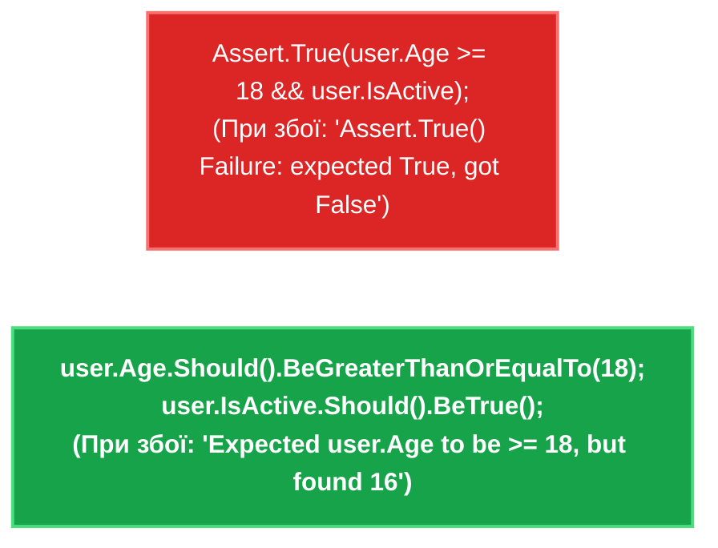

# 04. Сучасні перевірки: NSubstitute та виразні твердження FluentAssertions

## 1. Еволюція перевірок: Чому `Assert.Equal` поступається FluentAssertions?

Стандартні методи тверджень тестових фреймворків (`Assert.Equal(expected, actual)`) мають низку недоліків:
1. **Плутанина порядку аргументів**: Розробники часто випадково міняють місцями `expected` та `actual`. У разі збою фреймворк виводить безглузде повідомлення про помилку: "Expected 42, but was 100", коли насправді все навпаки.
2. **Низька виразність**: Перевірка складних колекцій, часових інтервалів або винятків вимагає багаторядкового громіздкого коду.

**FluentAssertions** вирішує ці проблеми, пропонуючи виразний fluent-синтаксис у стилі людської мови:



---

## 2. Ключові можливості бібліотеки FluentAssertions

### Перевірка колекцій та складних графів
```csharp
var users = await userService.GetActiveUsersAsync();

// Перевірка кількості та умов над елементами:
users.Should().NotBeNullOrEmpty()
    .And.HaveCount(3)
    .And.OnlyHaveUniqueItems()
    .And.Contain(u => u.Role == "Admin");

// Глибоке структурне порівняння всіх полів двох об'єктів:
actualOrder.Should().BeEquivalentTo(expectedOrder, options => options
    .Excluding(o => o.CreatedAt) // Ігноруємо динамічну дату створення
    .ComparingByMembers<OrderItem>());
```

### Перевірка винятків
```csharp
Func<Task> action = async () => await service.TransferMoneyAsync(-500);

await action.Should().ThrowAsync<ArgumentOutOfRangeException>()
    .WithMessage("*сума має бути більшою за нуль*");
```

---

## 3. NSubstitute: Мінімалістична та елегантна альтернатива Moq

Бібліотека **NSubstitute** набула великої популярності в екосистемі .NET завдяки відсутності обгортки `new Mock<T>()` та набагато природнішому C# синтаксису:

```csharp
// 1. Створення мока прямо через інтерфейс:
var repository = Substitute.For<IOrderRepository>();

// 2. Налаштування повернення результату (без складного Setup/Returns):
repository.GetByIdAsync(42).Returns(new Order { Id = 42, Total = 500 });

// 3. Перевірка факту виклику (Verify):
await service.ProcessAsync(42);

// Перевіряємо, що метод SaveChangesAsync викликався рівно 1 раз:
await repository.Received(1).SaveChangesAsync();

// Перевіряємо, що метод Delete ніколи не викликався:
await repository.DidNotReceive().DeleteAsync(Arg.Any<int>());
```

---

## 4. Порівняння бібліотек мокінгу: Moq проти NSubstitute

| Критерій | Moq | NSubstitute |
|:---|:---|:---|
| **Синтаксис створення** | `var mock = new Mock<IRepo>();` | `var mock = Substitute.For<IRepo>();` |
| **Доступ до об'єкта** | Через поле `mock.Object` | Сам мок і є об'єктом інтерфейсу `mock` |
| **Налаштування поведінки** | `mock.Setup(x => x.Do()).Returns(val);` | `mock.Do().Returns(val);` |
| **Верифікація викликів** | `mock.Verify(x => x.Do(), Times.Once);` | `mock.Received(1).Do();` |
| **Читабельність у тестах** | Добра, але присутній "шум" `.Object` | Максимально лаконічна, мінімум коду |

---

## 5. Матриця проєкту цієї секції

| Проєкт | Посилання на вихідний код | Що демонструє під капотом |
|:---|:---|:---|
| [`03-Testing.Moq`](../03-Testing.Moq/OrderCheckoutMoqStepByStepTests.cs) | [OrderCheckoutMoqStepByStepTests.cs](../03-Testing.Moq/OrderCheckoutMoqStepByStepTests.cs) | Практика написання модульних тестів за патерном AAA, налаштування мок-поведінки через Moq та застосування тверджень FluentAssertions. |
