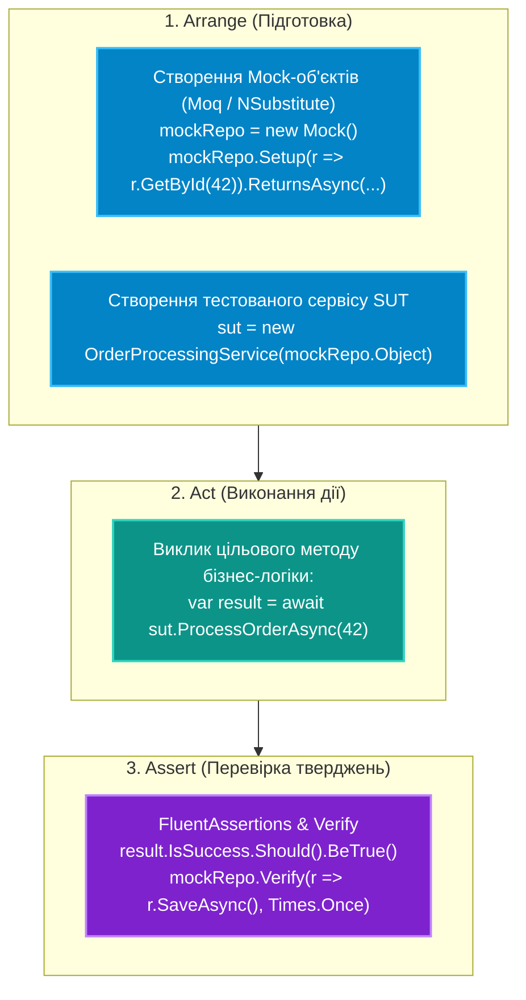

# Підмодуль 01: Модульне тестування, мокінг залежностей та перевірка якості (`OOP - Unit Testing and Mocking.sln`)

Цей фінальний модуль закріплює культуру автоматизованого тестування на платформі .NET. Тут розглядаються два найпопулярніших тестових фреймворки сучасної екосистеми — **xUnit** та **NUnit**, створення ізольованих фальшивих залежностей за допомогою провідної бібліотеки мокінгу **Moq** (а також альтернативи **NSubstitute**), виразні перевірки тверджень через **FluentAssertions** та тестування доступу до даних Entity Framework Core за допомогою InMemory та SQLite баз даних.

---

## Архітектурний конвеєр тестування AAA (Arrange-Act-Assert)



---

## Навігація по навчальних посібниках (`Docs`)

| № | Посібник | Ключові теми та системні інструменти | Посилання на документ |
|:---:|:---|:---|:---|
| 01 | **Основи xUnit: Архітектура та Життєвий цикл** | Атрибути `[Fact]`, `[Theory]`, `[InlineData]`, життєвий цикл тесту (новий екземпляр класу на кожен тест), спільні фікстури `IClassFixture` | [Docs/01_xUnit_Fundamentals.md](Docs/01_xUnit_Fundamentals.md) |
| 02 | **Основи NUnit та Порівняння з xUnit** | Атрибути `[Test]`, `[TestCase]`, `[SetUp]`, `[TearDown]`, порівняльна таблиця еквівалентів синтаксису між xUnit та NUnit | [Docs/02_NUnit_Fundamentals_And_Comparison.md](Docs/02_NUnit_Fundamentals_And_Comparison.md) |
| 03 | **Покроковий Мокінг із бібліотекою Moq** | Створення фальшивих залежностей `Mock<T>`, налаштування поведінки `Setup` / `ReturnsAsync`, верифікація викликів `Verify` та `Times.Once` | [Docs/03_Mocking_With_Moq_StepByStep.md](Docs/03_Mocking_With_Moq_StepByStep.md) |
| 04 | **Сучасні перевірки з NSubstitute та FluentAssertions** | Лаконічний синтаксис `Substitute.For<T>()`, ланцюжки тверджень `Should().BeGreaterThan()` замість `Assert.True` | [Docs/04_Mocking_With_NSubstitute_And_FluentAssertions.md](Docs/04_Mocking_With_NSubstitute_And_FluentAssertions.md) |
| 05 | **Тестування доступу до даних EF Core: SQLite vs InMemory** | Чому InMemoryProvider не підтримує реляційні обмеження, організація тестів репозиторіїв на реальній базі даних SQLite у пам'яті | [Docs/05_Testing_EFCore_SQLite_InMemory.md](Docs/05_Testing_EFCore_SQLite_InMemory.md) |

---

## Структура проєктів рішення `OOP - Unit Testing and Mocking.sln`

* **`Testing.Core.Domain`**:
  * Чистий доменний шар: сутності `Order`, `Product`, бізнес-правила, інтерфейси репозиторіїв `IOrderRepository`.
* **`01-Testing.xUnit`**:
  * Тестовий проєкт на базі xUnit: демонстрація параметризованих тестів `[Theory]` та життєвого циклу тестів.
  * Посилання на вихідний код: [`OrderTests.cs`](01-Testing.xUnit/BankAccountXUnitTests.cs).
* **`02-Testing.NUnit`**:
  * Аналогічні сценарії, реалізовані через атрибути NUnit (`[TestCase]`, `[SetUp]`).
  * Посилання на вихідний код: [`OrderNUnitTests.cs`](02-Testing.NUnit/BankAccountNUnitTests.cs).
* **`03-Testing.Moq`**:
  * Глибока ізоляція шарів бізнес-логіки через бібліотеку Moq: перевірка аргументів викликів через `It.Is<T>()`, викидання винятків через `ThrowsAsync`.
  * Посилання на вихідний код: [`OrderServiceMoqTests.cs`](03-Testing.Moq/OrderCheckoutMoqStepByStepTests.cs).
* **`Testing.EFCore.InMemoryTests`**:
  * Інтеграційні тести збереження даних із використанням контексту EF Core на SQLite in-memory.
  * Посилання на вихідний код: [`RepositoryIntegrationTests.cs`](Testing.EFCore.InMemoryTests/CustomerRepositoryTests.cs).

---

## Запуск усіх тестів рішення

```powershell
dotnet test "10-Testing-And-Quality/01-Unit-Testing-xUnit-Mocking/OOP - Unit Testing and Mocking.sln" -c Release
```
