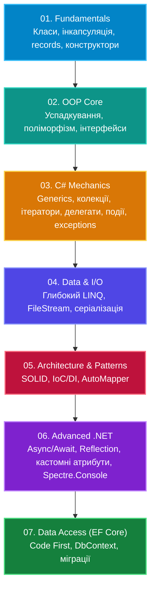

# C# & OOP Mastery: Від Основ до Архітектури в .NET 10

[](https://dotnet.microsoft.com/)
[](https://docs.microsoft.com/en-us/dotnet/csharp/)
[](https://github.com/)

Ласкаво просимо до повного практичного курсу та живої бази знань з **об'єктно-орієнтованого програмування, інженерних практик та архітектури на платформі .NET 10**.

Цей репозиторій є результатом консолідації, модернізації та систематизації розрізнених навчальних матеріалів в єдину цілісну екосистему. Кожен модуль спроектовано за принципом **«Теорія ➔ Антипатерн (Bad) ➔ Еталонне рішення (Good)»**.

---

## 🗺️ Дорожня карта курсу (Roadmap)



---

## 📚 Структура модулів курсу

| Модуль | Тематика | Ключові концепції | Статус |
|:---|:---|:---|:---:|
| **[01-Fundamentals](01-Fundamentals/)** | Основи класів та типи даних | Поля, властивості, інваріанти, конструктори, `record`, `static`, `IDisposable` | ✅ Завершено |
| **[02-OOP-Core](02-OOP-Core/)** | Ядро ООП | Наслідування, `override`/`new`, явна реалізація інтерфейсів, поліморфізм | ✅ Завершено |
| **[03-Csharp-Mechanics](03-Csharp-Mechanics/)** | Механізми платформи C# | `Generics`, внутрішня будова колекцій, `IEnumerator`, лямбди, події, фільтри помилок | ✅ Завершено |
| **[04-Data-And-IO](04-Data-And-IO/)** | Дані та потоки введення/виведення | LINQ-оператори, ліниві обчислення, `FileStream`, бінарне/текстове читання | ✅ Завершено |
| **[05-Architecture-And-Patterns](05-Architecture-And-Patterns/)** | Архітектурне проектування | SOLID-практикум, еволюція DI-контейнерів, DTO-патерни | ✅ Завершено |
| **[06-Advanced-DotNet](06-Advanced-DotNet/)** | Просунутий .NET | Асинхронність (`Task`, `async/await`), рефлексія типів, атрибути, CLI Spectre.Console | ✅ Завершено |
| **[07-DataAccess-EFCore](07-DataAccess-EFCore/)** | Доступ до реляційних БД | ORM Entity Framework Core, Code-First, міграції, Multi-Provider, Generic Host | ✅ Завершено |

---

## 🛠️ Вимоги до оточення та швидкий старт

- **SDK:** [.NET 10.0 SDK](https://dotnet.microsoft.com/download/dotnet/10.0) або новіший
- **IDE:** Visual Studio 2026 / Visual Studio Code / JetBrains Rider

### Клонування та збірка
```bash
git clone <URL_REPOSITORIA>
cd CSharp-OOP-Mastery
dotnet build
```

---

## 📋 Регламент проекту
- [RULES.md](RULES.md) — Повний регламент міграції, 7-кроковий чекліст переносу кожного модуля та стандарти документації.
- [MIGRATION_TRACKER.md](MIGRATION_TRACKER.md) — Живий статус міграції модулів.
