# C# & OOP Mastery: Від Основ до Архітектури в .NET 10

Ласкаво просимо до повного практичного курсу та живої бази знань з **об'єктно-орієнтованого програмування, багатопотоковості, баз даних, інженерних практик та архітектури на платформі .NET 10**.

Кожен модуль спроектовано за принципом **від простого до складного** та **«Теорія -> Антипатерн (Bad) -> Еталонне рішення (Good)»**, а всі навчальні `.md`-посібники підключені безпосередньо до віртуальних папок рішення (**Solution Folders**) та теки **`Docs`** у кожному `.sln`-файлі для зручного читання прямо у Visual Studio Solution Explorer.

---

## Дорожня карта курсу (Roadmap)

```mermaid
flowchart TD
    classDef fundClass fill:#0284c7,stroke:#38bdf8,color:#ffffff,stroke-width:2px;
    classDef oopClass fill:#0d9488,stroke:#2dd4bf,color:#ffffff,stroke-width:2px;
    classDef mechClass fill:#d97706,stroke:#fcd34d,color:#ffffff,stroke-width:2px;
    classDef dataClass fill:#4f46e5,stroke:#818cf8,color:#ffffff,stroke-width:2px;
    classDef metaClass fill:#7e22ce,stroke:#c084fc,color:#ffffff,stroke-width:2px;
    classDef mtClass fill:#0369a1,stroke:#7dd3fc,color:#ffffff,stroke-width:2px;
    classDef efClass fill:#15803d,stroke:#4ade80,color:#ffffff,stroke-width:2px;
    classDef archClass fill:#be123c,stroke:#fb7185,color:#ffffff,stroke-width:2px;
    classDef testClass fill:#059669,stroke:#34d399,color:#ffffff,stroke-width:2px;

    M1["01. Fundamentals<br/>Класи, інкапсуляція, конструктори, індексатори, struct/record, GC"]:::fundClass
    M2["02. OOP Core<br/>Успадкування, поліморфізм, інтерфейси"]:::oopClass
    M3["03. C# Mechanics<br/>Generics, колекції, ітератори, делегати, події, exceptions"]:::mechClass
    M4["04. Advanced C#<br/>Рефлексія, метадані й атрибути, глибокий LINQ, Expression Trees та власний DI"]:::metaClass
    M5["05. Files, Streams & Serialization<br/>FileStream, потокові адаптери, Excel, JSON/XML серіалізація, GZip/Brotli та ZIP"]:::dataClass
    M6["06. Multithreading & Parallelism<br/>Thread, ThreadPool, Lock/Monitor, Deadlock, Async/Await, Parallel, PLINQ, Channels"]:::mtClass
    M7["07. Data Access (EF Core)<br/>Повний курс за Metanit (DbContext, Fluent API, 1:1/1:N/N:M, LINQ to Entities, TPH/TPT/TPC, Raw SQL), MultiProvider, Bogus, Bulk Ops"]:::efClass
    M8["08. Architecture & Patterns<br/>SOLID, Generic Host (Config & Logging), Dependency Injection, AutoMapper DTO, Spectre.Console та 3-шаровий застосунок з EF Core"]:::archClass
    M9["09. Dynamic Programming & DLR<br/>Наочне DP для початківців (Мемоізація, Табуляція, Сходи, Кавовий автомат, Рюкзак), C# DLR (dynamic, ExpandoObject), IL Emit"]:::metaClass
    M10["10. Testing & Quality<br/>Модульне тестування xUnit, NUnit, покроковий курс Moq, NSubstitute, FluentAssertions та SQLite In-Memory"]:::testClass

    M1 --> M2 --> M3 --> M4 --> M5 --> M6 --> M7 --> M8 --> M9 --> M10
```

---

## Загальна таблиця глав курсу

| Глава | Тематика | Ключові концепції | Статус |
|:---|:---|:---|:---:|
| **[01-Fundamentals](#01-fundamentals--основи-класів-інкапсуляції-та-памяті)** | Основи класів, інкапсуляції та пам'яті | Поля, методи, 4 етапи інкапсуляції, конструктори, індексатори, оператори, композиція/агрегація, `struct` vs `record`, `GC` та `IDisposable` | Завершено |
| **[02-OOP-Core](#02-oop-core--ядро-ооп-успадкування-інтерфейси-та-поліморфізм)** | Ядро ООП | Наслідування, `virtual`/`override`/`new`, абстрактні класи, приведення типів (`Upcasting`/`Downcasting`), явна реалізація інтерфейсів, поліморфізм | Завершено |
| **[03-Csharp-Mechanics](#03-csharp-mechanics--механізми-платформи-c)** | Механізми платформи C# | `Generics`, внутрішня будова колекцій, `IEnumerator`, делегати, події, обробка винятків (`Exceptions`) | Завершено |
| **[04-Advanced-CSharp](#04-advanced-csharp--поглиблений-c-рефлексія-атрибути-linq-та-дерева-виразів)** | Поглиблений C#: Рефлексія, Атрибути, LINQ та Expression Trees | `Type`, `Assembly`, `MemberInfo`, варіантність, `[UnsafeAccessor]`, власний DI, користувацькі атрибути та валідація, 101 LINQ-оператор, `Expression<Func<T>>`, динамічні LINQ-предикати та трансляція `IQueryable` | Завершено |
| **[05-Files-Streams-And-Serialization](#05-files-streams-and-serialization--файли-потоки-та-серіалізація-даних)** | Файли, потоки та серіалізація даних | `FileStream`, `StreamReader`/`BinaryWriter`, `FileInfo`/`DirectoryInfo`, Excel (`NPOI`), `System.Text.Json`, поліморфний JSON, `XmlSerializer`, `XDocument`, власні JSON/XML серіалізатори на рефлексії, `GZipStream`/`BrotliStream`, `ZipArchive`, `FileSystemWatcher` | Завершено |
| **[06-Multithreading-And-Parallelism](#06-multithreading-and-parallelism--багатопотоковість-асинхронність-та-паралелізм)** | Багатопотоковість, Асинхронність і Паралелізм | `Thread`, `ThreadPool`, `Race Condition`, `Interlocked`, `lock` / `.NET 10 Lock`, `Deadlock`, `SemaphoreSlim`, `ConcurrentDictionary`, `async/await`, `Parallel.ForEachAsync`, `PLINQ`, `Channels` | Завершено |
| **[07-DataAccess-EFCore](#07-dataaccess-efcore--доступ-до-даних-та-entity-framework-core)** | Доступ до реляційних БД (EF Core) | Повний курс EF Core (`DbContext`, `ChangeTracker`, `Data Annotations` vs `Fluent API`, зв'язки `1:1`/`1:N`/`N:M`, `Include`/`AsSplitQuery`, `LINQ to Entities`, `TPH`/`TPT`/`TPC`, `Owned Types`, `Raw SQL`, транзакції, оптимістична конкуренція, `Global Query Filters`, `ExecuteUpdateAsync`, `Interceptors`, `Bogus Seeding`) | Завершено |
| **[08-Architecture-And-Patterns](#08-architecture-and-patterns--архітектура-solid-generic-host-di-automapper-та-spectreconsole)** | Архітектура, SOLID, Generic Host, DI, AutoMapper та Spectre.Console | **SOLID**, **Generic Host** (`IHost`, `BackgroundService`, `IConfiguration`/`IOptions<T>`, `ILogger<T>`), **Dependency Injection** (`Transient`/`Scoped`/`Singleton`, `Captive Dependency`, `Keyed Services`), **AutoMapper & DTO**, **Spectre.Console CLI** та **3-шаровий інтеграційний застосунок (DataAccess + BusinessLogic + ConsoleUI)** | Завершено |
| **[09-Dynamic-Programming](#09-dynamic-programming--динамічне-програмування-та-dlr)** | Динамічне програмування та DLR | Наочне алгоритмічне DP для студентів (`Memoization`, `Tabulation`, Сходи, Решта в кавовому автоматі, Туристичний рюкзак 0/1, Відстань Левенштейна, `Generic Memoizer`), C# DLR (`dynamic`, `ExpandoObject`), кодогенерація (`DynamicMethod`) | Завершено |
| **[10-Testing-And-Quality](#10-testing-and-quality--модульне-тестування-та-надійність-xunit-nunit-moq)** | Модульне тестування та надійність (`xUnit`, `NUnit`, `Moq`) | Окремі практичні модулі **`xUnit`** (`[Fact]`, `[Theory]`, `IClassFixture`), **`NUnit`** (`[Test]`, `[TestCase]`, `Assert.That`), покроковий курс **`Moq`** (6 уроків від стабів до `Verify`, `Callbacks` і `MockSequence`), `NSubstitute` + `FluentAssertions` та `SQLite In-Memory` для EF Core | Завершено |

---

## Детальна навігація по секціях та папках репозиторію

### `01-Fundamentals` — Основи класів, інкапсуляції та пам'яті

#### 1.1. [`01-Classes-And-Encapsulation`](01-Fundamentals/01-Classes-And-Encapsulation/README.md) (`OOP-Classes.sln`)
| Секція у Solution Explorer | Навчальний `.md`-посібник | Проєкти у секції |
|:---|:---|:---|
| **00. Вступ до C# (Intro)** | [00_Intro_To_CSharp.md](01-Fundamentals/01-Classes-And-Encapsulation/Docs/00_Intro_To_CSharp.md) | `01_ConsoleAndTypes`, `02_ControlFlowAndLoops`, `03_Methods`, `04_CoolStuff_FromCppToCsharp` |
| **01. Перший Клас, Об'єкти та Пам'ять** | [01_Classes_Objects_Memory_Model.md](01-Fundamentals/01-Classes-And-Encapsulation/Docs/01_Classes_Objects_Memory_Model.md) | `SOLIS-p074` (перший клас і `new`), `SOLIS-p075` (поля і методи), `SOLIS-p114` (Stack vs Heap) |
| **02. Методи Класу та Параметри** | [02_Methods_And_Parameter_Passing.md](01-Fundamentals/01-Classes-And-Encapsulation/Docs/02_Methods_And_Parameter_Passing.md) | `SOLIS-p095` (By-Value), `SOLIS-p098` (`ref`), `SOLIS-p100`/`p102` (`out`), `SOLIS-p105` (`in`), `SOLIS-p107` (`params`), `SOLIS-p110` (Overloading), `SOLIS-p112` (Optional), `SOLIS-p113` (Named), `SOLIS-p115` (Рекурсія) |
| **03. Статика, Константи та this** | [04_Static_Const_Readonly_And_This.md](01-Fundamentals/01-Classes-And-Encapsulation/Docs/04_Static_Const_Readonly_And_This.md) | `SOLIS-p119` (`static` метод), `SOLIS-p120` (`static` поле), `SOLIS-p122` (`const`), `SOLIS-p123` (`readonly`), `SOLIS-p124` (`this`) |
| **04. Еволюція Інкапсуляції та Властивості** | [03_Encapsulation_Properties_And_Invariants.md](01-Fundamentals/01-Classes-And-Encapsulation/Docs/03_Encapsulation_Properties_And_Invariants.md) | `SOLIS-p126`, `01_Problem_PublicField` -> `02_Solution_AccessorMethods` -> `03_Solution_Property` -> `04_Solution_BehaviorInvariants` |

#### 1.2. [`02-Advanced-Classes`](01-Fundamentals/02-Advanced-Classes/README.md) (`OOP-More-About-Сlasses.sln`)
| Секція у Solution Explorer | Навчальний `.md`-посібник | Проєкти у секції |
|:---|:---|:---|
| **01. Поля, Статика та Незмінність** | [01_Static_Members_And_Immutability.md](01-Fundamentals/02-Advanced-Classes/Docs/01_Static_Members_And_Immutability.md) | `SOLIS-p132`, `SOLIS-p135`, `SOLIS-p137`, `SOLIS-p140`, `SOLIS-p156` (статичний конструктор), `Ex-Readonly-vs-Const`, `Ex-Static-Class` |
| **02. Властивості та Валідація** | [02_Properties_And_Validation.md](01-Fundamentals/02-Advanced-Classes/Docs/02_Properties_And_Validation.md) | `SOLIS-p145` (backing field), `SOLIS-p149` (обчислювані), `SOLIS-p150` (авто-властивості), `SOLIS-p151` (`static`), `SOLIS-p170` (`private set`), `Ex-Property-Validation` |
| **03. Конструктори, Ініціалізатори та this** | [03_Constructors_And_This.md](01-Fundamentals/02-Advanced-Classes/Docs/03_Constructors_And_This.md) | `Ex-Default-Constructor`, `SOLIS-p153`, `SOLIS-p158` (`new T { ... }`), `SOLIS-p160`, `Ex-This-In-Constructor-01`, `Ex-This-In-Constructor-02` |
| **04. Індексатори та Перевантаження Операторів** | [04_Indexers_And_Operators.md](01-Fundamentals/02-Advanced-Classes/Docs/04_Indexers_And_Operators.md) | `SOLIS-p168`, `Ex-Indexers-01`, `Ex-Idexers-02`, `Ex-Operator-Overloading` |
| **05. Методи Розширення, Вкладені та Partial Класи** | [05_Extension_Methods_And_Nested_Classes.md](01-Fundamentals/02-Advanced-Classes/Docs/05_Extension_Methods_And_Nested_Classes.md) | `Ex-Extension-Methods`, `Ex-Nested-Class`, `SOLIS-p174` (`partial`) |
| **06. Управління Ресурсами та Записи** | [06_IDisposable_And_Records.md](01-Fundamentals/02-Advanced-Classes/Docs/06_IDisposable_And_Records.md) | `Ex-IDisposable-Finalizer`, `Ex-Record-vs-Class` |

#### 1.3. [`03-Structs-Records-Composition-And-GC`](01-Fundamentals/03-Structs-Records-Composition-And-GC/README.md) (`OOP-Structs-Records-Composition-GC.sln`)
| Секція у Solution Explorer | Навчальний `.md`-посібник | Проєкти у секції |
|:---|:---|:---|
| **01. Композиція та Агрегація Класів (Has-A)** | [01_Composition_And_Aggregation.md](01-Fundamentals/03-Structs-Records-Composition-And-GC/Docs/01_Composition_And_Aggregation.md) | `01-CompositionVsAggregation` (`Order`, `Customer`, `OrderLineItem`) |
| **02. Struct проти Class та Boxing** | [02_Structs_And_Boxing.md](01-Fundamentals/03-Structs-Records-Composition-And-GC/Docs/02_Structs_And_Boxing.md) | `02-StructVsClassAndBoxing` (`readonly struct`, Stack vs Heap, `Boxing`/`Unboxing`) |
| **03. Record проти Class та Рівність** | [03_Records_And_Value_Equality.md](01-Fundamentals/03-Structs-Records-Composition-And-GC/Docs/03_Records_And_Value_Equality.md) | `03-RecordEqualityAndWith` (`Reference Equality` vs `Value Equality`, `with`, `Deconstruct`) |
| **04. Пам'ять, Garbage Collector та IDisposable** | [04_Garbage_Collector_And_IDisposable.md](01-Fundamentals/03-Structs-Records-Composition-And-GC/Docs/04_Garbage_Collector_And_IDisposable.md) | `04-GarbageCollectorAndIDisposable` (`Gen 0/1/2`, `GC.GetGeneration`, `WeakReference`, `using`) |

---

### `02-OOP-Core` — Ядро ООП: Успадкування, Інтерфейси та Поліморфізм

#### 2.1. [`01-Inheritance`](02-OOP-Core/01-Inheritance/README.md) (`OOP-Inheritance.sln`)
| Секція у Solution Explorer | Навчальний `.md`-посібник | Проєкти у секції |
|:---|:---|:---|
| **01. Базове спадкування, ключове слово base та конструктори** | [01_Inheritance_Basics_And_Base_Keyword.md](02-OOP-Core/01-Inheritance/Docs/01_Inheritance_Basics_And_Base_Keyword.md) | `SOLIS-p177`, `SOLIS-p180` (`new`), `SOLIS-p181` (`base.Field1`), `SOLIS-p196` (`: base(...)`), `Ex-ThisInConstructor` (`: this(...)`) |
| **02. Віртуальні члени (virtual), Перевизначення (override) vs Приховування (new)** | [02_Virtual_Override_And_New_Hiding.md](02-OOP-Core/01-Inheritance/Docs/02_Virtual_Override_And_New_Hiding.md) | `SOLIS-p183` (`new` через базовий тип), `SOLIS-p185` (`virtual`/`override`), `SOLIS-p187`, `SOLIS-p188` (розрив ланцюжка `vtable`), `SOLIS-p189` (віртуальні властивості) |
| **03. Абстрактні класи та абстрактні члени (abstract)** | [03_Abstract_Classes_And_Members.md](02-OOP-Core/01-Inheritance/Docs/03_Abstract_Classes_And_Members.md) | `SOLIS-p207` (`abstract class`), `SOLIS-p208` (поєднання стану та абстрактних членів) |
| **04. Приведення типів в ієрархії (Upcasting, Downcasting, is, as)** | [04_Type_Casting_Upcasting_Downcasting.md](02-OOP-Core/01-Inheritance/Docs/04_Type_Casting_Upcasting_Downcasting.md) | `Ex-Upcasting`, `Ex-Downcasting` (`is`), `Ex-AsOperator` (`as`) |
| **05. Запечатані класи (sealed), Статичні класи та Методи розширення** | [05_Sealed_Static_And_Extension_Methods.md](02-OOP-Core/01-Inheritance/Docs/05_Sealed_Static_And_Extension_Methods.md) | `Ex-SealedClass` (`sealed class`, `sealed override`), `SOLIS-p210` (`static class`), `SOLIS-p212`, `SOLIS-p214` (`this MyData`), `Ex-ExtensionMethods` |

#### 2.2. [`02-Interfaces-And-Polymorphism`](02-OOP-Core/02-Interfaces-And-Polymorphism/README.md) (`OOP - Interfaces.sln`)
| Секція у Solution Explorer | Навчальний `.md`-посібник | Проєкти у секції |
|:---|:---|:---|
| **01. Контракти інтерфейсів (Оголошення, реалізація, інтерфейсні посилання)** | [01_Interface_Contracts_And_References.md](02-OOP-Core/02-Interfaces-And-Polymorphism/Docs/01_Interface_Contracts_And_References.md) | `p389[SOLIS]` (`IInfo`), `p397[SOLIS]`, `p399[SOLIS]`, `p413[SOLIS]` (`ILiveBirth` + `as`) |
| **02. Множинна реалізація, колізії імен та Явна реалізація (Explicit Implementation)** | [02_Multiple_And_Explicit_Implementation.md](02-OOP-Core/02-Interfaces-And-Polymorphism/Docs/02_Multiple_And_Explicit_Implementation.md) | `p401[SOLIS]`, `p402[SOLIS]`, `p404[SOLIS]`, `p408[SOLIS]` (`void IIfc1.PrintOut`) |
| **03. Еволюція інтерфейсів (Default Interface Methods у C# 8+)** | [03_Modern_Interfaces_CSharp8_Plus.md](02-OOP-Core/02-Interfaces-And-Polymorphism/Docs/03_Modern_Interfaces_CSharp8_Plus.md) | `InterfacesAfterCSharpVer8` (DIM, `static` фабрики, `private`/`protected` члени) |
| **04. Стандартні інтерфейси .NET BCL (IComparable, IComparer, IEnumerable, ICloneable, IDisposable)** | [04_Standard_BCL_Interfaces.md](02-OOP-Core/02-Interfaces-And-Polymorphism/Docs/04_Standard_BCL_Interfaces.md) | `p390[SOLIS]`, `p393[SOLIS]`, `ex-Icomparable01`..`02`, `ex-IComparer01`..`02`, `ex-IEnumerable01`..`02`, `ex-IClonable01`..`02`, `ex-IDisposable01`..`02` |
| **05. Інтерфейси у зв'язках об'єктів (Асоціація, Агрегація, Композиція)** | [05_Interfaces_In_UML_Relationships.md](02-OOP-Core/02-Interfaces-And-Polymorphism/Docs/05_Interfaces_In_UML_Relationships.md) | `InterfacesAssociation`, `InterfacesAggregation`, `InterfacesComposition` |

#### 2.3. [`03-Polymorphism-And-Hierarchy-Design`](02-OOP-Core/03-Polymorphism-And-Hierarchy-Design/README.md) (`OOP-Polymorphism-And-Design.sln`)
| Секція у Solution Explorer | Навчальний `.md`-посібник | Проєкти у секції |
|:---|:---|:---|
| **01. Корінь ієрархії System.Object та семантика рівності** | [01-SystemObjectAndEquality.md](02-OOP-Core/03-Polymorphism-And-Hierarchy-Design/01-SystemObjectAndEquality.md) | `01-SystemObjectAndEquality` (`ToString`, `Equals`, `GetHashCode`, `MemberwiseClone`) |
| **02. Інкапсуляція в ієрархіях (protected, internal, private protected)** | [02-HierarchyEncapsulationAndProtected.md](02-OOP-Core/03-Polymorphism-And-Hierarchy-Design/02-HierarchyEncapsulationAndProtected.md) | `02-HierarchyEncapsulationAndProtected` (`BankAccount`, `SavingsAccount`, `CreditLineAccount`) |
| **03. Абстрактний клас проти Інтерфейсу та патерн Template Method** | [03-AbstractClassVsInterface.md](02-OOP-Core/03-Polymorphism-And-Hierarchy-Design/03-AbstractClassVsInterface.md) | `03-AbstractClassVsInterface` (`ReportExporter`, `ICompressible`, `IEncryptable`) |
| **04. Поліморфізм замість умовних операторів та Композиція проти Спадкування** | [04-PolymorphismAndCompositionDesign.md](02-OOP-Core/03-Polymorphism-And-Hierarchy-Design/04-PolymorphismAndCompositionDesign.md) | `04-PolymorphismAndCompositionDesign` (`IShippingRule`, `GameUnit`) |

---

### `03-Csharp-Mechanics` — Механізми платформи C#
* **[`01-Generics`](03-Csharp-Mechanics/01-Generics/README.md)** (`OOP - Generics.sln`) — Узагальнені типи, обмеження `where T : ...`, коваріантність/контраваріантність.
* **[`02-Collections`](03-Csharp-Mechanics/02-Collections/README.md)** — Внутрішня будова `List<T>`, `Dictionary<TKey, TValue>`, `HashSet<T>`, `Queue<T>`, `Stack<T>`.
* **[`03-Enumerators-And-Iterators`](03-Csharp-Mechanics/03-Enumerators-And-Iterators/README.md)** (`OOP - Enumerators.sln`) — `IEnumerable<T>`, `IEnumerator<T>`, кінцевий автомат `yield return`.
* **[`04-Delegates-And-Events`](03-Csharp-Mechanics/04-Delegates-And-Events/README.md)** (`OOP - Delegates-Events.sln`) — Делегати, `Action`/`Func`/`Predicate`, замикання, події `event` та `EventHandler<T>`.
* **[`05-Exceptions-Handling`](03-Csharp-Mechanics/05-Exceptions-Handling/README.md)** (`OOP - Exception.sln`) — Розкрутка стека, `try/catch/finally`, фільтри `when`, користувацькі винятки (`ExceptionsBasics`, `ExceptionsCustom`).

---

### `04-Advanced-CSharp` — Поглиблений C#: Рефлексія, Атрибути, LINQ та Дерева виразів

#### 4.1. [`01-Reflection`](04-Advanced-CSharp/01-Reflection/README.md) (`OOP - Reflection.sln`)
| Секція у Solution Explorer | Навчальний `.md`-посібник | Проєкти у секції |
|:---|:---|:---|
| **01. Система типів та інспекція метаданих** | [01_Type_System_And_Metadata_Inspection.md](04-Advanced-CSharp/01-Reflection/Docs/01_Type_System_And_Metadata_Inspection.md) | `00-Shared`, `p696[SOLIS]`, `p698[SOLIS]`, `reflection-example-intro-01`, `01-TypeofDemo`..`06-GetInterfacesDemo` |
| **02. Члени типу, інкапсуляція та прапорці пошуку** | [02_Members_And_BindingFlags.md](04-Advanced-CSharp/01-Reflection/Docs/02_Members_And_BindingFlags.md) | `reflection-ex-04`..`10`, `07-GetFieldsPropertiesDemo`..`11-GetEventsDemo` |
| **03. Рефлексія узагальнень та варіантності** | [03_Late_Binding_And_Generics.md](04-Advanced-CSharp/01-Reflection/Docs/03_Late_Binding_And_Generics.md) | `12-GenericsReflectionDemo`, `13.1-CovarianceAndContravarianceDemo`, `13.2-VarianceReflectionInspectionDemo` |
| **04. Пізнє зв'язування, Reflection.Emit та UnsafeAccessor** | [04_IL_Generation_And_Reflection_Emit.md](04-Advanced-CSharp/01-Reflection/Docs/04_IL_Generation_And_Reflection_Emit.md), [06_Performance_Optimization_And_Native_AOT.md](04-Advanced-CSharp/01-Reflection/Docs/06_Performance_Optimization_And_Native_AOT.md) | `14-LateBindingDemo`, `reflection-example-late-binding-01`..`02`, `reflection-example-intro-02`..`03`, `16-UnsafeAccessorDemo` |
| **05. Побудова власного IoC та DI контейнера** | [07_IoC_Container_Deep_Dive.md](04-Advanced-CSharp/01-Reflection/Docs/07_IoC_Container_Deep_Dive.md) | `25.1-DependencyInjectionDemo`, `25.2-DependencyInjectionRealWorld` |

#### 4.2. [`02-Attributes-And-Metadata`](04-Advanced-CSharp/02-Attributes-And-Metadata/README.md) (`OOP-Attributes-And-Metadata.sln`)
| Секція у Solution Explorer | Навчальний `.md`-посібник | Проєкти у секції |
|:---|:---|:---|
| **01. Системні атрибути компілятора та Caller Info** | [01_Custom_Attributes_Fundamentals.md](04-Advanced-CSharp/02-Attributes-And-Metadata/Docs/01_Custom_Attributes_Fundamentals.md) | `p701[SOLIS]` (`[Obsolete]`), `p703[SOLIS]` (`[Conditional]`), `p704[SOLIS]` (`[CallerMemberName]`), `attribute-example-02` |
| **02. Проєктування власних атрибутів та таблиці метаданих** | [02_Metadata_Querying_And_Runtime_Processing.md](04-Advanced-CSharp/02-Attributes-And-Metadata/Docs/02_Metadata_Querying_And_Runtime_Processing.md), [04_Custom_Attributes_Deep_Dive.md](04-Advanced-CSharp/02-Attributes-And-Metadata/Docs/04_Custom_Attributes_Deep_Dive.md) | `00-Shared`, `p717[SOLIS]`, `p718[SOLIS]`, `attribute-example-01`, `attribute-example-03`, `attribute-example-04`, `17-AttributesBasicsDemo` |
| **03. Декларативна валідація моделей та правил у Runtime** | [03_Attributes_And_Metadata_Validation.md](04-Advanced-CSharp/02-Attributes-And-Metadata/Docs/03_Attributes_And_Metadata_Validation.md), [05_Class_And_Property_Validation_Engine.md](04-Advanced-CSharp/02-Attributes-And-Metadata/Docs/05_Class_And_Property_Validation_Engine.md) | `18-AttributesValidationDemo` |

#### 4.3. [`03-LINQ`](04-Advanced-CSharp/03-LINQ/README.md) (`101 LINQ Samples.sln`)
| Секція у Solution Explorer | Навчальний `.md`-посібник | Проєкти у секції |
|:---|:---|:---|
| **01. Архітектура LINQ, відкладене виконання та спільне джерело даних** | [01-LINQ-Architecture-and-Execution.md](04-Advanced-CSharp/03-LINQ/docs/01-LINQ-Architecture-and-Execution.md) | `LinqSamplesCommon`, `n_QueryExecution`, `p_101 LINQ Samples` |
| **02. Фільтрація та проєкція послідовностей (Where, Select, SelectMany)** | [02-Filtering-and-Projections.md](04-Advanced-CSharp/03-LINQ/docs/02-Filtering-and-Projections.md) | `a_RestrictionOperators`, `b_ProjectionOperators` |
| **03. Пагінація та сортування (Take, Skip, OrderBy, ThenBy, Reverse)** | [03-Partitioning-and-Ordering.md](04-Advanced-CSharp/03-LINQ/docs/03-Partitioning-and-Ordering.md) | `c_PartitioningOperators`, `d_OrderingOperators` |
| **04. Групування та множинні операції (GroupBy, Distinct, Union, Intersect, Except)** | [04-Grouping-and-Set-Operators.md](04-Advanced-CSharp/03-LINQ/docs/04-Grouping-and-Set-Operators.md) | `e_GroupingOperators`, `f_SetOperators` |
| **05. Реляційні з'єднання та агрегація (Join, GroupJoin, Count, Sum, Min, Max, Aggregate)** | [05-Joins-and-Aggregate-Operators.md](04-Advanced-CSharp/03-LINQ/docs/05-Joins-and-Aggregate-Operators.md) | `o_JoinOperators`, `k_AggregateOperators` |
| **06. Квантори, елементні оператори, генерація, конвертація та власні розширення** | [06-Quantifiers-Elements-Conversion-and-Custom.md](04-Advanced-CSharp/03-LINQ/docs/06-Quantifiers-Elements-Conversion-and-Custom.md) | `g_ConversionOperators`, `h_ElementOperators`, `i_GenerationOperators`, `j_Quantifiers`, `l_MiscellaneousOperators`, `m_CustomSequenceOperators` |

#### 4.4. [`04-Expression-Trees`](04-Advanced-CSharp/04-Expression-Trees/README.md) (`OOP - Expression Trees.sln`)
| Секція у Solution Explorer | Навчальний `.md`-посібник | Проєкти у секції |
|:---|:---|:---|
| **01. Анатомія дерев виразів (AST) та ручне конструювання у Runtime** | [01_Expression_Trees_AST_And_Dynamic_Building.md](04-Advanced-CSharp/04-Expression-Trees/Docs/01_Expression_Trees_AST_And_Dynamic_Building.md) | `15.0-ExpressionTreesBasicsDemo`, `15.1-ExpressionTreesBuildingDemo` |
| **02. Компіляція швидких делегатів та бустінг рефлексії (Expression vs Invoke)** | [02_Compiled_Delegates_And_Reflection_Boosting.md](04-Advanced-CSharp/04-Expression-Trees/Docs/02_Compiled_Delegates_And_Reflection_Boosting.md) | `00-Shared`, `15.2-ExpressionTreesMemberAccessDemo`, `15.3-ReflectionPerformanceDemo` |
| **03. Динамічні LINQ-предикати, ExpressionVisitor та трансляція IQueryable** | [03_Dynamic_LINQ_Predicates_And_IQueryable_Translation.md](04-Advanced-CSharp/04-Expression-Trees/Docs/03_Dynamic_LINQ_Predicates_And_IQueryable_Translation.md) | `15.4-DynamicLinqPredicateBuilderDemo` |

---

### `05-Files-Streams-And-Serialization` — Файли, потоки та серіалізація даних

#### 5.1. [`01-Files-And-Streams`](05-Files-Streams-And-Serialization/01-Files-And-Streams/README.md) (`OOP-WorkWithFilesInC#.slnx`)
| Секція у Solution Explorer | Навчальний `.md`-посібник | Проєкти у секції |
|:---|:---|:---|
| **01. Архітектура потоків та FileStream** | [01_Streams_Architecture_And_FileStream.md](05-Files-Streams-And-Serialization/01-Files-And-Streams/Docs/01_Streams_Architecture_And_FileStream.md) | `01-01-FileStream`..`01-03-FileStream` |
| **02. Текстові та бінарні адаптери потоків** | [02_Text_And_Binary_Readers_Writers.md](05-Files-Streams-And-Serialization/01-Files-And-Streams/Docs/02_Text_And_Binary_Readers_Writers.md) | `02-01`..`02-06-StreamReader-StreamWriter`, `04-01`..`04-02-TextWriter-TextReader`, `05-01`..`05-02-BinaryWriter-BinaryReader`, `06-01`..`06-02-StringWriter-StringReader` |
| **03. Файлова система: File vs FileInfo, DirectoryInfo** | [03_File_And_FileInfo_Directory_And_DirectoryInfo.md](05-Files-Streams-And-Serialization/01-Files-And-Streams/Docs/03_File_And_FileInfo_Directory_And_DirectoryInfo.md) | `03-01`..`03-06-FileClass`, `07-01`..`07-08-FileInfoClass`, `08-01`..`08-05-DirectoryInfoClass` |
| **04. Експорт та імпорт табличних даних Excel (NPOI)** | [04_Excel_Data_Import_Export.md](05-Files-Streams-And-Serialization/01-Files-And-Streams/Docs/04_Excel_Data_Import_Export.md) | `09-01-ExportAndImportExcelData`, `09-02-ExportAndImportExcelData` |

#### 5.2. [`02-Serialization-And-Data-Formats`](05-Files-Streams-And-Serialization/02-Serialization-And-Data-Formats/README.md) (`OOP-Serialization-And-Data-Formats.sln`)
| Секція у Solution Explorer | Навчальний `.md`-посібник | Проєкти у секції |
|:---|:---|:---|
| **01. Серіалізація JSON (System.Text.Json, Streams, Polymorphism, Utf8JsonWriter)** | [01_Json_And_Xml_Serialization_Fundamentals.md](05-Files-Streams-And-Serialization/02-Serialization-And-Data-Formats/Docs/01_Json_And_Xml_Serialization_Fundamentals.md), [02_Json_Streams_Polymorphism_And_Xml.md](05-Files-Streams-And-Serialization/02-Serialization-And-Data-Formats/Docs/02_Json_Streams_Polymorphism_And_Xml.md) | `00-Shared`, `19-SerializationBasicsJsonDemo`, `19.1-JsonStreamsAndPolymorphismDemo` |
| **02. Серіалізація XML та LINQ to XML (XmlSerializer, XDocument, XmlReader)** | [02_Json_Streams_Polymorphism_And_Xml.md](05-Files-Streams-And-Serialization/02-Serialization-And-Data-Formats/Docs/02_Json_Streams_Polymorphism_And_Xml.md) | `20-SerializationBasicsXmlDemo` |
| **03. Власні серіалізатори та десеріалізатори під капотом (Reflection & Custom Attributes)** | [03_Custom_Reflection_Serializers_Under_The_Hood.md](05-Files-Streams-And-Serialization/02-Serialization-And-Data-Formats/Docs/03_Custom_Reflection_Serializers_Under_The_Hood.md) | `21-JsonSerializationDemo`, `22-XmlSerializationDemo`, `23-JsonDeserializationDemo`, `24-XmlDeserializationDemo` |
| **04. Стиснення потоків (GZip, Brotli), ZIP-архіви та реактивний FileSystemWatcher** | [04_Stream_Compression_Zip_And_FileSystemWatcher.md](05-Files-Streams-And-Serialization/02-Serialization-And-Data-Formats/Docs/04_Stream_Compression_Zip_And_FileSystemWatcher.md) | `25-CompressionAndZipArchivesDemo`, `26-FileSystemWatcherAndCsvPipelineDemo` |

---

### `06-Multithreading-And-Parallelism` — Багатопотоковість, Асинхронність та Паралелізм

#### 6.1. [`01-Multithreading-Basics`](06-Multithreading-And-Parallelism/01-Multithreading-Basics/README.md) (`OOP - Multithreading.sln`)
| Секція у Solution Explorer | Навчальний `.md`-посібник | Проєкти у секції |
|:---|:---|:---|
| **01. Потоки ОС (Thread) та Пул потоків (ThreadPool)** | [01_Threads_And_ThreadPool.md](06-Multithreading-And-Parallelism/01-Multithreading-Basics/Docs/01_Threads_And_ThreadPool.md) | `01-ThreadBasics`, `02-ThreadPoolAndWorkItems` |
| **02. Стан гонитви (Race Condition) та атомарні операції Interlocked** | [02_Race_Conditions_And_Interlocked.md](06-Multithreading-And-Parallelism/01-Multithreading-Basics/Docs/02_Race_Conditions_And_Interlocked.md) | `03-RaceConditionAndInterlocked` |
| **03. Ізоляція стану потоку (ThreadLocal та AsyncLocal)** | [03_ThreadLocal_And_AsyncLocal.md](06-Multithreading-And-Parallelism/01-Multithreading-Basics/Docs/03_ThreadLocal_And_AsyncLocal.md) | `04-ThreadLocalAndAsyncLocal` |

#### 6.2. [`02-Synchronization-And-ThreadSafety`](06-Multithreading-And-Parallelism/02-Synchronization-And-ThreadSafety/README.md) (`OOP - Synchronization.sln`)
| Секція у Solution Explorer | Навчальний `.md`-посібник | Проєкти у секції |
|:---|:---|:---|
| **01. Критичні секції: lock, Monitor та .NET 10 System.Threading.Lock** | [01_Lock_Monitor_And_DotNet9_Lock.md](06-Multithreading-And-Parallelism/02-Synchronization-And-ThreadSafety/Docs/01_Lock_Monitor_And_DotNet9_Lock.md) | `01-LockAndMonitor` |
| **02. Взаємне блокування (Deadlock) та ієрархічне впорядкування ресурсів** | [02_Deadlocks_And_Prevention.md](06-Multithreading-And-Parallelism/02-Synchronization-And-ThreadSafety/Docs/02_Deadlocks_And_Prevention.md) | `02-DeadlockAndPrevention` |
| **03. Семафори (SemaphoreSlim) та блокування читання-запису (ReaderWriterLockSlim)** | [03_SemaphoreSlim_And_ReaderWriterLock.md](06-Multithreading-And-Parallelism/02-Synchronization-And-ThreadSafety/Docs/03_SemaphoreSlim_And_ReaderWriterLock.md) | `03-SemaphoreSlimAndReaderWriterLock` |
| **04. Потокобезпечні колекції (ConcurrentDictionary, ConcurrentQueue)** | [04_Concurrent_Collections.md](06-Multithreading-And-Parallelism/02-Synchronization-And-ThreadSafety/Docs/04_Concurrent_Collections.md) | `04-ConcurrentCollections` |

#### 6.3. [`03-Asynchronous-Programming`](06-Multithreading-And-Parallelism/03-Asynchronous-Programming/README.md) (`OOP - Asynchronous Programming.sln`)
| Секція у Solution Explorer | Навчальний `.md`-посібник | Проєкти у секції |
|:---|:---|:---|
| **01. Основи async/await, Tasks та повернення значень** | [01_Async_Await_Architecture_And_State_Machine.md](06-Multithreading-And-Parallelism/03-Asynchronous-Programming/Docs/01_Async_Await_Architecture_And_State_Machine.md) | `01-AsyncAndAwait`, `02-Tasks`, `03-ReturnAValueFromTask-Console`, `03-ReturnAValueFromTask-ConsolewithERROR`, `03-ReturnComplexTypeValueFromАTask`, `03-ReturnAValueFromTask-API` |
| **02. Координація багатьох задач (Task.WhenAll, WhenAny, Throttling)** | [02_Task_Coordination_And_Combinators.md](06-Multithreading-And-Parallelism/03-Asynchronous-Programming/Docs/02_Task_Coordination_And_Combinators.md) | `04-ExecuteMultipleTasks`, `04-ExecuteMultipleTasks-Task.WhenAll`, `05-LimitTheNumberOfConcurrentTasks`, `06-HandleResponseWhenExecutingMultipleTasks` |
| **03. Кооперативне скасування (CancellationToken) та обробка винятків** | [03_Cancellation_Tokens_And_Cooperative_Cancellation.md](06-Multithreading-And-Parallelism/03-Asynchronous-Programming/Docs/03_Cancellation_Tokens_And_Cooperative_Cancellation.md), [04_Exception_Handling_In_Async_Code.md](06-Multithreading-And-Parallelism/03-Asynchronous-Programming/Docs/04_Exception_Handling_In_Async_Code.md) | `CancellationTokenToCancelATask`, `EX_05-exceptions` |
| **04. Практичні сценарії та еволюція асинхронного коду (EX_01..EX_04)** | [01_Async_Await_Architecture_And_State_Machine.md](06-Multithreading-And-Parallelism/03-Asynchronous-Programming/Docs/01_Async_Await_Architecture_And_State_Machine.md) | `EX_01_async_await`, `EX_02_async_await`, `EX_03_async_await`, `EX_04_async_await` |

#### 6.4. [`04-Parallel-And-Channels`](06-Multithreading-And-Parallelism/04-Parallel-And-Channels/README.md) (`OOP - Parallel and Channels.sln`)
| Секція у Solution Explorer | Навчальний `.md`-посібник | Проєкти у секції |
|:---|:---|:---|
| **01. Паралельна обробка даних (Parallel.ForEachAsync та PLINQ)** | [01_Parallel_ForEachAsync_And_PLINQ.md](06-Multithreading-And-Parallelism/04-Parallel-And-Channels/Docs/01_Parallel_ForEachAsync_And_PLINQ.md) | `Parallel.Processing.Demo` |
| **02. Асинхронні черги Producer-Consumer (System.Threading.Channels)** | [02_Channels_Producer_Consumer.md](06-Multithreading-And-Parallelism/04-Parallel-And-Channels/Docs/02_Channels_Producer_Consumer.md) | `Channels.ProducerConsumer.Demo` |
| **03. Обмеження паралелізму та кооперативне скасування (SemaphoreSlim & CancellationToken)** | [03_Synchronization_And_Cancellation.md](06-Multithreading-And-Parallelism/04-Parallel-And-Channels/Docs/03_Synchronization_And_Cancellation.md) | `Concurrency.Throttling.Demo` |

---

### `07-DataAccess-EFCore` — Доступ до даних та Entity Framework Core

#### 7.1. [`01-EFCore-Complete-Mastery`](07-DataAccess-EFCore/01-EFCore-Complete-Mastery/README.md) (`OOP-EFCore-Complete-Mastery.sln`) — Повний покроковий курс EF Core (за структурою Metanit)
| Секція у Solution Explorer | Навчальний `.md`-посібник | Проєкти у секції |
|:---|:---|:---|
| **01. Вступ, DbContext, CRUD та ChangeTracker** | [01_DbContext_CRUD_And_ChangeTracker.md](07-DataAccess-EFCore/01-EFCore-Complete-Mastery/Docs/01_DbContext_CRUD_And_ChangeTracker.md) | `01-EfCoreBasicsAndCrud` (`EnsureCreated`, `CRUD`, `ChangeTracker`, `LogTo`) |
| **02. Моделювання сутностей: Data Annotations проти Fluent API** | [02_Entity_Modeling_Annotations_And_FluentAPI.md](07-DataAccess-EFCore/01-EFCore-Complete-Mastery/Docs/02_Entity_Modeling_Annotations_And_FluentAPI.md) | `02-EntityModelingAndFluentApi` (`IEntityTypeConfiguration<T>`, складені ключі, індекси, `Shadow Properties`, `Value Conversions`) |
| **03. Зв'язки між таблицями (1:1, 1:N, N:M) та стратегії завантаження** | [03_Relationships_Cascade_And_Loading.md](07-DataAccess-EFCore/01-EFCore-Complete-Mastery/Docs/03_Relationships_Cascade_And_Loading.md) | `03-RelationshipsAndLoadingStrategies` (`One-to-One`, `One-to-Many`, `Many-to-Many` з payload, `Include`/`ThenInclude`, `Explicit Loading`, `AsSplitQuery`) |
| **04. LINQ to Entities: Фільтрація, групування, пагінація та AsNoTracking** | [04_Linq_To_Entities_Queries_And_Tracking.md](07-DataAccess-EFCore/01-EFCore-Complete-Mastery/Docs/04_Linq_To_Entities_Queries_And_Tracking.md) | `04-LinqToEntitiesAndQueries` (`EF.Functions.Like`, проєкції, `GroupBy`, `Join`, `AsNoTrackingWithIdentityResolution`, `CompileAsyncQuery`) |
| **05. Спадкування в реляційній БД (TPH, TPT, TPC) та Owned Types** | [05_Inheritance_Strategies_TPH_TPT_TPC.md](07-DataAccess-EFCore/01-EFCore-Complete-Mastery/Docs/05_Inheritance_Strategies_TPH_TPT_TPC.md) | `05-InheritanceAndComplexTypes` (`Table-Per-Hierarchy`, `Table-Per-Type`, `Table-Per-Concrete-Type`, `OwnsOne`) |
| **06. Сирий SQL, Транзакції, Оптимістична конкуренція, Global Filters та Bulk Ops** | [06_RawSql_Transactions_And_Concurrency.md](07-DataAccess-EFCore/01-EFCore-Complete-Mastery/Docs/06_RawSql_Transactions_And_Concurrency.md) | `06-SqlTransactionsConcurrencyAndFilters` (`FromSqlInterpolated`, `SqlQuery<T>`, `BeginTransactionAsync` + `CreateSavepointAsync`, `[ConcurrencyCheck]`, `HasQueryFilter`, `ExecuteUpdateAsync`/`ExecuteDeleteAsync`) |

#### 7.2. [`02-CodeFirst-MultiProvider`](07-DataAccess-EFCore/02-CodeFirst-MultiProvider/README.md) (`CodeFirst.sln`)
| Секція у Solution Explorer | Навчальний `.md`-посібник | Проєкти у секції |
|:---|:---|:---|
| **01. Доменна модель та контракти** | [01_EFCore_CodeFirst_Architecture_And_Models.md](07-DataAccess-EFCore/02-CodeFirst-MultiProvider/Docs/01_EFCore_CodeFirst_Architecture_And_Models.md) | `CodeFirst.Models` |
| **02. Базовий DbContext, Fluent API та бізнес-сервіси** | [02_FluentAPI_And_Configurations.md](07-DataAccess-EFCore/02-CodeFirst-MultiProvider/Docs/02_FluentAPI_And_Configurations.md) | `CodeFirst.DataAccess`, `CodeFirst.Services` |
| **03. Мультипровайдерні міграції (SQLite, PostgreSQL, SQL Server, MySQL)** | [03_Migrations_CLI_And_MultiDatabase.md](07-DataAccess-EFCore/02-CodeFirst-MultiProvider/Docs/03_Migrations_CLI_And_MultiDatabase.md) | `CodeFirst.Sqlite`, `CodeFirst.Postgres`, `CodeFirst.SqlServer`, `CodeFirst.MySql` |
| **04. Консольні клієнти та приклади використання** | [03_Migrations_CLI_And_MultiDatabase.md](07-DataAccess-EFCore/02-CodeFirst-MultiProvider/Docs/03_Migrations_CLI_And_MultiDatabase.md) | `CodeFirst.Sample`, `CodeFirst.SimpleExample` |

#### 7.3. [`03-EFCore-Advanced-And-Tuning`](07-DataAccess-EFCore/03-EFCore-Advanced-And-Tuning/README.md) (`EFCoreAdvancedAndTuning.slnx`)
* [01_Inheritance_Mapping_TPH_TPT_TPC.md](07-DataAccess-EFCore/03-EFCore-Advanced-And-Tuning/Docs/01_Inheritance_Mapping_TPH_TPT_TPC.md), [02_Bogus_Seeding_And_Data_Generation.md](07-DataAccess-EFCore/03-EFCore-Advanced-And-Tuning/Docs/02_Bogus_Seeding_And_Data_Generation.md), [03_Performance_BulkOps_And_Interceptors.md](07-DataAccess-EFCore/03-EFCore-Advanced-And-Tuning/Docs/03_Performance_BulkOps_And_Interceptors.md) — генерація тестових даних через `Bogus`, `JSON Columns`, перехоплювачі `DbCommandInterceptor` та масові операції.

#### 7.4. [`04-EFCore-Practical-Scenarios`](07-DataAccess-EFCore/04-EFCore-Practical-Scenarios/README.md) (`OOP-EF-Core-Entertainment.sln`)
* [01_Generic_Host_And_Hosted_Services.md](07-DataAccess-EFCore/04-EFCore-Practical-Scenarios/Docs/01_Generic_Host_And_Hosted_Services.md), [02_Complex_EFCore_Domain_And_Queries.md](07-DataAccess-EFCore/04-EFCore-Practical-Scenarios/Docs/02_Complex_EFCore_Domain_And_Queries.md), [03_Cross_Cutting_Concerns_Cache_Export_Perf.md](07-DataAccess-EFCore/04-EFCore-Practical-Scenarios/Docs/03_Cross_Cutting_Concerns_Cache_Export_Perf.md) — комплексна доменна модель парку розваг з аналітичними запитами, кешуванням та експортом.

---

### `08-Architecture-And-Patterns` — Архітектура, SOLID, Generic Host, DI, AutoMapper та Spectre.Console

#### 8.1. [`01-SOLID-Principles`](08-Architecture-And-Patterns/01-SOLID-Principles/README.md) (`OOP - SOLID.sln`)
| Секція у Solution Explorer | Навчальний `.md`-посібник | Проєкти у секції |
|:---|:---|:---|
| **S..D. Принципи SOLID (SRP, OCP, LSP, ISP, DIP)** | [01_Single_Responsibility_Principle.md](08-Architecture-And-Patterns/01-SOLID-Principles/OOP%20-%20SOLID/Docs/01_Single_Responsibility_Principle.md) .. [05_Dependency_Inversion_Principle.md](08-Architecture-And-Patterns/01-SOLID-Principles/OOP%20-%20SOLID/Docs/05_Dependency_Inversion_Principle.md) | `S`, `O`, `L`, `I`, `D` (пари `Bad` vs `Good`) |
| **DIP_IoC_DI_Evolution** | [06_DIP_IoC_DI_Containers_DeepDive.md](08-Architecture-And-Patterns/01-SOLID-Principles/OOP%20-%20SOLID/Docs/06_DIP_IoC_DI_Containers_DeepDive.md) | `DIP_IoC_DI_Evolution` |

#### 8.2. [`02-Generic-Host-Configuration-And-Logging`](08-Architecture-And-Patterns/02-Generic-Host-Configuration-And-Logging/README.md) (`OOP - Generic Host Configuration and Logging.sln`)
| Секція у Solution Explorer | Навчальний `.md`-посібник | Проєкти у секції |
|:---|:---|:---|
| **01. Основи Generic Host та Фонові Сервіси (IHost, BackgroundService)** | [01_Generic_Host_And_Background_Services.md](08-Architecture-And-Patterns/02-Generic-Host-Configuration-And-Logging/Docs/01_Generic_Host_And_Background_Services.md) | `01-GenericHostAndLifecycle` (`Host.CreateApplicationBuilder`, `IHostedService`, `BackgroundService`, `IHostApplicationLifetime`) |
| **02. Система Конфігурації та Патерн Options (appsettings.json, IOptions)** | [02_Configuration_And_Options_Pattern.md](08-Architecture-And-Patterns/02-Generic-Host-Configuration-And-Logging/Docs/02_Configuration_And_Options_Pattern.md) | `02-ConfigurationAndOptionsPattern` (`IConfiguration`, `appsettings.json`, `IOptions<T>`, `IOptionsMonitor<T>`, `ValidateDataAnnotations`) |
| **03. Структуроване Логування та Scopes (ILogger)** | [03_Structured_Logging_And_Scopes.md](08-Architecture-And-Patterns/02-Generic-Host-Configuration-And-Logging/Docs/03_Structured_Logging_And_Scopes.md) | `03-StructuredLoggingAndScopes` (`ILogger<T>`, `LogLevel`, `BeginScope`, `[LoggerMessage]`) |

#### 8.3. [`03-Dependency-Injection`](08-Architecture-And-Patterns/03-Dependency-Injection/README.md) (`OOP - Dependency Injection.sln`)
| Секція у Solution Explorer | Навчальний `.md`-посібник | Проєкти у секції |
|:---|:---|:---|
| **01. Час життя сервісів (Transient, Scoped, Singleton)** | [01_Service_Lifetimes_Transient_Scoped_Singleton.md](08-Architecture-And-Patterns/03-Dependency-Injection/Docs/01_Service_Lifetimes_Transient_Scoped_Singleton.md) | `01-ServiceLifetimesDemo` |
| **02. Управління областями (IServiceScopeFactory) та пастка Captive Dependency** | [02_IServiceScopeFactory_And_Captive_Dependency.md](08-Architecture-And-Patterns/03-Dependency-Injection/Docs/02_IServiceScopeFactory_And_Captive_Dependency.md) | `02-ScopesAndCaptiveDependencyDemo` (`ValidateScopes`) |
| **03. Множинна реєстрація та Іменовані сервіси (Keyed Services .NET 8/10)** | [03_Multiple_Implementations_And_Keyed_Services.md](08-Architecture-And-Patterns/03-Dependency-Injection/Docs/03_Multiple_Implementations_And_Keyed_Services.md) | `03-MultipleImplementationsAndKeyedServicesDemo` (`IEnumerable<T>`, `[FromKeyedServices]`) |

#### 8.4. [`04-AutoMapper-And-DTO`](08-Architecture-And-Patterns/04-AutoMapper-And-DTO/README.md) (`OOP - Serialization-AutoMapper.sln`)
| Секція у Solution Explorer | Навчальний `.md`-посібник | Проєкти у секції |
|:---|:---|:---|
| **01. Патерн DTO, профілі AutoMapper та серіалізація** | [01_DTO_Pattern_And_Object_Mapping.md](08-Architecture-And-Patterns/04-AutoMapper-And-DTO/Docs/01_DTO_Pattern_And_Object_Mapping.md), [02_AutoMapper_Profiles_And_Advanced_Config.md](08-Architecture-And-Patterns/04-AutoMapper-And-DTO/Docs/02_AutoMapper_Profiles_And_Advanced_Config.md), [03_Serialization_Patterns_JSON_XML.md](08-Architecture-And-Patterns/04-AutoMapper-And-DTO/Docs/03_Serialization_Patterns_JSON_XML.md) | `SerializationAndAutoMapper` |

#### 8.5. [`05-CLI-Spectre-Console`](08-Architecture-And-Patterns/05-CLI-Spectre-Console/README.md) (`SpectreConsoleExamples.sln`)
| Секція у Solution Explorer | Навчальний `.md`-посібник | Проєкти у секції |
|:---|:---|:---|
| **01. Візуальні компоненти, таблиці, дерева, діаграми та інтерактивні меню Spectre.Console** | [01_Spectre_Console_Basics_And_Markup.md](08-Architecture-And-Patterns/05-CLI-Spectre-Console/Docs/01_Spectre_Console_Basics_And_Markup.md), [02_Interactive_Prompts_And_Widgets.md](08-Architecture-And-Patterns/05-CLI-Spectre-Console/Docs/02_Interactive_Prompts_And_Widgets.md), [03_CLI_Commands_And_Architecture.md](08-Architecture-And-Patterns/05-CLI-Spectre-Console/Docs/03_CLI_Commands_And_Architecture.md) | 20+ проєктів (`Tables`, `Trees`, `Panels`, `Prompts`, `Progress`, `Live`, `Status`, `Charts`, `Cli` тощо) |

#### 8.6. [`06-SpectreConsole-EFCore-Tiered-App`](08-Architecture-And-Patterns/06-SpectreConsole-EFCore-Tiered-App/README.md) (`OOP - SpectreConsole EFCore Tiered App.sln`) — Повноцінний 3-шаровий застосунок на Spectre.Console + EF Core
| Секція у Solution Explorer | Навчальний `.md`-посібник | Проєкти у секції |
|:---|:---|:---|
| **01. Шар Доступу до Даних (Data Access Layer - EF Core & Repositories)** | [01_Three_Tier_Architecture_EFCore_And_SpectreConsole.md](08-Architecture-And-Patterns/06-SpectreConsole-EFCore-Tiered-App/Docs/01_Three_Tier_Architecture_EFCore_And_SpectreConsole.md) | `StoreApp.DataAccess` (сутності `Category`, `Product`, `CustomerOrder`, `StoreDbContext` на SQLite, репозиторії) |
| **02. Шар Бізнес-Логіки (Business Logic Layer - Services, DTO & AutoMapper)** | [01_Three_Tier_Architecture_EFCore_And_SpectreConsole.md](08-Architecture-And-Patterns/06-SpectreConsole-EFCore-Tiered-App/Docs/01_Three_Tier_Architecture_EFCore_And_SpectreConsole.md) | `StoreApp.BusinessLogic` (`CatalogBusinessService`, бізнес-правила знижок і залишків, `StoreMappingProfile`, `StoreSettings`, `ILogger`) |
| **03. Консольний Інтерфейс (Presentation Layer - Generic Host & Spectre.Console)** | [01_Three_Tier_Architecture_EFCore_And_SpectreConsole.md](08-Architecture-And-Patterns/06-SpectreConsole-EFCore-Tiered-App/Docs/01_Three_Tier_Architecture_EFCore_And_SpectreConsole.md) | `StoreApp.ConsoleUI` (`Host.CreateApplicationBuilder`, `appsettings.json`, DI, інтерактивне меню та `--demo` режим на `Spectre.Console`) |

---

### `09-Dynamic-Programming` — Динамічне програмування та DLR

#### 9.1. [`09-Dynamic-Programming`](09-Dynamic-Programming/README.md) (`DynamicProgramming.sln`)
| Секція у Solution Explorer | Навчальний `.md`-посібник | Проєкти у секції |
|:---|:---|:---|
| **01. Алгоритмічне Динамічне Програмування (Мемоізація, Табуляція, Сходи, Монети, Рюкзак)** | [00_Curriculum_And_Roadmap.md](09-Dynamic-Programming/Docs/00_Curriculum_And_Roadmap.md), [01_Algorithmic_Dynamic_Programming.md](09-Dynamic-Programming/Docs/01_Algorithmic_Dynamic_Programming.md) | `01-Memoization-Basics` (Top-Down), `02-Tabulation-Basics` (Bottom-Up), `03-Classic-DP-Problems` (Сходи, Кавовий автомат, Туристичний рюкзак 0/1, Відстань Левенштейна), `04-Generic-Memoizer-Pattern` |
| **02. Динамічне середовище виконання C# (DLR, dynamic, ExpandoObject)** | [02_CSharp_Dynamic_And_DLR_Internals.md](09-Dynamic-Programming/Docs/02_CSharp_Dynamic_And_DLR_Internals.md) | `05-Dynamic-Keyword-And-DLR`, `06-ExpandoObject-And-DynamicObject` |
| **03. Динамічна генерація коду (IL Emit та Expression Trees)** | [03_Dynamic_Metaprogramming_And_Code_Generation.md](09-Dynamic-Programming/Docs/03_Dynamic_Metaprogramming_And_Code_Generation.md) | `07-DynamicMethod-Emit`, `08-Expression-Trees-Dynamic-Compilation` |
| **04. Інтеграційний конвеєр (Dynamic Pipeline Engine)** | [04_Capstone_Pipeline_Deep_Dive.md](09-Dynamic-Programming/Docs/04_Capstone_Pipeline_Deep_Dive.md) | `09-Dynamic-Pipeline-Engine` |

---

### `10-Testing-And-Quality` — Модульне тестування та надійність (`xUnit`, `NUnit`, `Moq`)

#### 10.1. [`01-Unit-Testing-xUnit-Mocking`](10-Testing-And-Quality/01-Unit-Testing-xUnit-Mocking/README.md) (`OOP-Unit-Testing-Masterclass.sln`)
| Секція у Solution Explorer | Навчальний `.md`-посібник | Проєкти у секції |
|:---|:---|:---|
| **00. Предметна область для тестування (Domain & Contracts)** | [01_xUnit_Fundamentals.md](10-Testing-And-Quality/01-Unit-Testing-xUnit-Mocking/Docs/01_xUnit_Fundamentals.md) | `Testing.Core.Domain` (`BankAccount`, `OrderCheckoutService`, інтерфейси залежностей) |
| **01. Модульне тестування на xUnit (Fact, Theory, Fixtures)** | [01_xUnit_Fundamentals.md](10-Testing-And-Quality/01-Unit-Testing-xUnit-Mocking/Docs/01_xUnit_Fundamentals.md) | `01-Testing.xUnit` (AAA, `[Fact]`, `[Theory]`, `[InlineData]`, `[MemberData]`, `[ClassData]`, `IClassFixture<T>`, `ITestOutputHelper`) |
| **02. Модульне тестування на NUnit (Test, TestCase, Assert.That)** | [02_NUnit_Fundamentals_And_Comparison.md](10-Testing-And-Quality/01-Unit-Testing-xUnit-Mocking/Docs/02_NUnit_Fundamentals_And_Comparison.md) | `02-Testing.NUnit` (`[SetUp]`/`[TearDown]`, `[Test]`, `[TestCase]`, `[TestCaseSource]`, Constraint-модель `Assert.That`) |
| **03. Ізоляція залежностей та Мокінг через бібліотеку Moq** | [03_Mocking_With_Moq_StepByStep.md](10-Testing-And-Quality/01-Unit-Testing-xUnit-Mocking/Docs/03_Mocking_With_Moq_StepByStep.md) | `03-Testing.Moq` (6 покрокових уроків: від ручних Fake/Stub до `Mock<T>`, `It.Is<T>`, `ThrowsAsync`, `Verify`, `Callback`, `MockBehavior.Strict` та `MockSequence`) |
| **04. Альтернативний стек (NSubstitute, FluentAssertions) та EF Core In-Memory** | [04_Mocking_With_NSubstitute_And_FluentAssertions.md](10-Testing-And-Quality/01-Unit-Testing-xUnit-Mocking/Docs/04_Mocking_With_NSubstitute_And_FluentAssertions.md), [05_Testing_EFCore_SQLite_InMemory.md](10-Testing-And-Quality/01-Unit-Testing-xUnit-Mocking/Docs/05_Testing_EFCore_SQLite_InMemory.md) | `Testing.UnitTests` (`NSubstitute` + `FluentAssertions`), `Testing.EFCore.InMemoryTests` (`SQLite In-Memory`) |

---

## Вимоги до оточення
- **SDK:** [.NET 10.0 SDK](https://dotnet.microsoft.com/download/dotnet/10.0)
- **IDE:** Visual Studio 2026 / Visual Studio Code / JetBrains Rider
