# C# & OOP Mastery: Від Основ до Архітектури в .NET 10

Ласкаво просимо до повного практичного курсу та живої бази знань з **об'єктно-орієнтованого програмування, багатопотоковості, баз даних, інженерних практик та архітектури на платформі .NET 10**.

Кожен модуль спроектовано за принципом **від простого до складного** та **«Теорія -> Антипатерн (Bad) -> Еталонне рішення (Good)»**, а всі навчальні `.md`-посібники підключені безпосередньо до віртуальної папки **`Docs`** у кожному `.sln`-рішенні для зручного читання прямо у Visual Studio Solution Explorer.

---

## Дорожня карта курсу (Roadmap)

```mermaid
flowchart TD
    classDef fundClass fill:#0284c7,stroke:#38bdf8,color:#ffffff,stroke-width:2px;
    classDef oopClass fill:#0d9488,stroke:#2dd4bf,color:#ffffff,stroke-width:2px;
    classDef mechClass fill:#d97706,stroke:#fcd34d,color:#ffffff,stroke-width:2px;
    classDef dataClass fill:#4f46e5,stroke:#818cf8,color:#ffffff,stroke-width:2px;
    classDef metaClass fill:#7e22ce,stroke:#c084fc,color:#ffffff,stroke-width:2px;
    classDef mtClass fill:#0369a1,stroke:#7dd3fc,color:#ffffff,stroke-width:2px;
    classDef efClass fill:#15803d,stroke:#4ade80,color:#ffffff,stroke-width:2px;
    classDef archClass fill:#be123c,stroke:#fb7185,color:#ffffff,stroke-width:2px;
    classDef testClass fill:#059669,stroke:#34d399,color:#ffffff,stroke-width:2px;

    M1["01. Fundamentals<br/>Класи, інкапсуляція, records, конструктори"]:::fundClass
    M2["02. OOP Core<br/>Успадкування, поліморфізм, інтерфейси"]:::oopClass
    M3["03. C# Mechanics<br/>Generics, колекції, ітератори, делегати, події, exceptions"]:::mechClass
    M4["04. Data & I/O<br/>Глибокий LINQ, FileStream, потоки введення/виведення"]:::dataClass
    M5["05. Advanced .NET (Reflection & Metadata)<br/>Рефлексія, метадані, Expression Trees, атрибути, серіалізація, власний DI"]:::metaClass
    M6["06. Multithreading & Parallelism<br/>Thread, ThreadPool, Lock/Monitor, Deadlock, Async/Await, Parallel, PLINQ, Channels"]:::mtClass
    M7["07. Data Access (EF Core)<br/>Code-First, TPH/TPT/TPC, Bogus Seeding, Bulk Operations, Interceptors"]:::efClass
    M8["08. Architecture & Patterns<br/>SOLID, Dependency Injection, Generic/Web Host, AutoMapper DTO, Spectre.Console, EF Core + Clean Architecture"]:::archClass
    M9["09. Testing & Quality<br/>xUnit, NSubstitute, FluentAssertions, SQLite In-Memory"]:::testClass
    M10["10. Dynamic Programming & DLR<br/>Алгоритмічне DP (Memoization, Tabulation), C# DLR (dynamic, ExpandoObject), IL Emit"]:::metaClass

    M1 --> M2 --> M3 --> M4 --> M5 --> M6 --> M7 --> M8 --> M9 --> M10
```

---

## Структура глав курсу

| Глава | Тематика | Ключові концепції | Статус |
|:---|:---|:---|:---:|
| **[01-Fundamentals](01-Fundamentals/)** | Основи класів та типи даних | Поля, властивості, інваріанти, конструктори, `record`, `static`, `IDisposable` | Завершено |
| **[02-OOP-Core](02-OOP-Core/)** | Ядро ООП | Наслідування, `override`/`new`, явна реалізація інтерфейсів, поліморфізм | Завершено |
| **[03-Csharp-Mechanics](03-Csharp-Mechanics/)** | Механізми платформи C# | `Generics`, внутрішня будова колекцій, `IEnumerator`, лямбди, події, винятки (`Exceptions`) | Завершено |
| **[04-Data-And-IO](04-Data-And-IO/)** | Дані та потоки введення/виведення | LINQ-оператори, ліниві обчислення, `FileStream`, бінарне/текстове читання | Завершено |
| **[05-Advanced-DotNet](05-Advanced-DotNet/)** | Метапрограмування, Рефлексія та Атрибути | `Type`, `Assembly`, `MemberInfo`, варіантність, `Expression<T>`, `[UnsafeAccessor]`, власні атрибути, JSON/XML серіалізація та самописний DI-контейнер | Завершено |
| **[06-Multithreading-And-Parallelism](06-Multithreading-And-Parallelism/)** | Багатопотоковість, Асинхронність і Паралелізм | `Thread`, `ThreadPool`, `Race Condition`, `Interlocked`, `lock` / `.NET 10 Lock`, `Deadlock`, `SemaphoreSlim`, `ConcurrentDictionary`, `async/await`, `Parallel.ForEachAsync`, `PLINQ`, `Channels` | Завершено |
| **[07-DataAccess-EFCore](07-DataAccess-EFCore/)** | Доступ до реляційних БД (EF Core) | ORM Entity Framework Core, `TPH/TPT/TPC`, `Bogus Seeding`, `JSON Columns`, `ExecuteUpdateAsync`, `Interceptors` | Завершено |
| **[08-Architecture-And-Patterns](08-Architecture-And-Patterns/)** | Архітектура, SOLID, DI, AutoMapper та CLI | **SOLID**, **Dependency Injection** (`Lifetimes`, `Generic/Web Host`), **AutoMapper & DTO**, **Spectre.Console CLI** та **інтеграційний проєкт з EF Core** | Завершено |
| **[09-Testing-And-Quality](09-Testing-And-Quality/)** | Тестування та надійність | **xUnit, NSubstitute (мокінг), FluentAssertions, SQLite In-Memory тестування репозиторіїв** | Завершено |
| **[10-Dynamic-Programming](10-Dynamic-Programming/)** | Динамічне програмування та DLR | **Алгоритмічне DP** (Top-Down, Bottom-Up, Knapsack, Coin Change, Levenshtein), **C# DLR (`dynamic`, ExpandoObject)**, кодогенерація (`DynamicMethod`) | Завершено |
