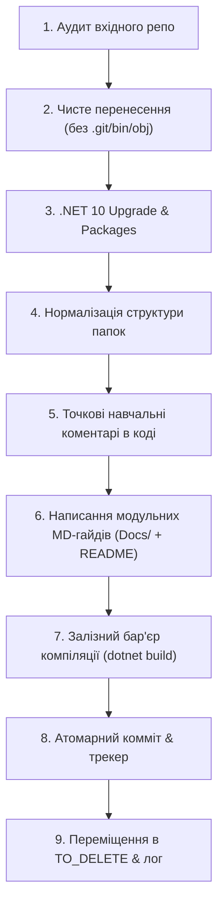

# Правила та Регламент Міграції: CSharp-OOP-Mastery (Лекції та Концептуальні приклади)

Цей документ визначає суворі стандарти, правила архітектури, регламент переносу та чекліст валідації для консолідації репозиторіїв курсу ООП.

---

## 1. Стратегія двох репозиторіїв (Two-Repository Architecture)

За рішенням архітектури на виході створюється **два окремих монорепозиторії**:

1. 🏛️ **`CSharp-OOP-Mastery` (Цей репозиторій):**
   * **Призначення:** Лекційний матеріал, поглиблена теорія, концептуальні приклади, архітектурні патерни, механізми CLR та .NET 10.
   * **Склад:** 19 тематичних модулів (від класів до EF Core та SOLID).
2. 🔬 **`CSharp-OOP-Laboratories` (Окремий репозиторій-близнюк):**
   * **Призначення:** Практичні лабораторні роботи (Lab01 – Lab20) у єдиному репозиторії із завданнями, інструкціями у форматі Markdown та стартовими/еталонними проектами.

---

## 2. Стратегія атомарних гілок (Feature-Branch Isolation Workflow)

Для забезпечення повної атомарності, безпеки та збереження всіх локальних змін кожна тема та кожна лабораторна розробляється в **окремій ізольованій гілці**:

1. **Ізольована гілка під кожен модуль:**
   * Для лекцій та прикладів: `feat/<number>-<topic>` (наприклад: `feat/01-classes-and-encapsulation`, `feat/02-inheritance`).
   * Для лабораторних робіт: `lab/<number>-<topic>` (наприклад: `lab/01-introduction`, `lab/05-inheritance`).
2. **Збереження всіх існуючих доробок та локальних змін:**
   * Усі незакомічені локальні зміни або чернетки зі старого репозиторію переносяться безпосередньо у відповідну гілку, де вони фіксуються в історії. Жодна правка не губиться.
3. **Зручність перемикання та незалежного тестування:**
   * Будь-якої миті ви можете перемкнутися на потрібну гілку (`git checkout ...`), запустити рішення, відредагувати код лабораторної або перевірити завдання без ризику вплинути на інші модулі.
4. **Контрольоване злиття в `main`:**
   * Після повної перевірки (0 помилок компіляції, перевірені гайди та коментарі) гілка зливається в `main`.
   * Гілка може залишатися локально та на GitHub як пряме посилання на окрему лабу/тему.
   * `main` завжди залишається чистим, надійним та готовим до публікації.

---

## 3. Цільова структура лекційного репозиторію

```text
CSharp-OOP-Mastery/
│
├── .editorconfig                          # Глобальні правила форматування C#
├── .gitignore                             # Виключення артефактів .NET, VS, Rider, OS
├── Directory.Build.props                  # Глобальні налаштування .NET 10, Nullable, LangVersion
├── README.md                              # Головна вітрина: Roadmap, навігація, інструкції
├── RULES.md                               # Цей регламент та правила міграції
├── MIGRATION_TRACKER.md                   # Трекер прогресу перенесення всіх 19 модулів
│
├── 01-Fundamentals/                       # Базові поняття ООП та мови C#
│   ├── 01-Classes-And-Encapsulation/      # Класи, поля, методи доступу, властивості
│   └── 02-Advanced-Classes/               # Конструктори, record, static, nested, IDisposable
│
├── 02-OOP-Core/                           # Фундаментальні стовпи ООП
│   ├── 01-Inheritance/                    # Успадкування, віртуальні методи, override/new/base
│   └── 02-Interfaces-And-Polymorphism/    # Інтерфейси, явна реалізація, поліморфізм
│
├── 03-Csharp-Mechanics/                   # Розширені механізми C#
│   ├── 01-Generics/                       # Узагальнення, обмеження where, ко/контраваріантність
│   ├── 02-Collections/                    # List, Dictionary, HashSet, внутрішня будова
│   ├── 03-Enumerators-And-Iterators/      # IEnumerable, IEnumerator, yield return
│   ├── 04-Delegates-And-Events/           # Делегати, анонімні методи, лямбди, події
│   └── 05-Exceptions-Handling/            # Try-catch-finally, custom exceptions, when filters
│
├── 04-Data-And-IO/                        # Робота з даними, колекціями та файлами
│   ├── 01-LINQ/                           # LINQ to Objects, проекції, вибірки, lazy evaluation
│   └── 02-Files-And-Streams/              # FileStream, StreamReader, File/FileInfo, серіалізація
│
├── 05-Architecture-And-Patterns/          # Архітектура та інженерні практики
│   ├── 01-SOLID-Principles/               # SRP, OCP, LSP, ISP, DIP + еволюція IoC/DI
│   └── 02-AutoMapper-And-DTO/             # Об'єктний мапінг, проекція моделей
│
├── 06-Advanced-DotNet/                    # Просунуті можливості платформи
│   ├── 01-Asynchronous-Programming/       # Task, async/await, CancellationToken, паралелізм
│   ├── 02-Reflection-And-Metadata/        # Type, Assembly, пізнє зв'язування
│   ├── 03-Custom-Attributes/              # Кастомні атрибути, декларативна валідація
│   └── 04-CLI-Spectre-Console/            # Сучасні консольні UI-інтерфейси
│
└── 07-DataAccess-EFCore/                  # Доступ до даних та ORM
    ├── 01-CodeFirst-Basics/               # DbContext, моделі, Fluent API, міграції
    └── 02-EFCore-Practical-Scenarios/     # Запити, зв'язки, відстеження сутностей
```

---

## 3. Суворий оновлений пайплайн переносу кожного модуля (The Iron Pipeline)

Жоден модуль не вважається перенесеним, доки послідовно не виконано **всі 8 кроків**:



### Крок 1: Аудит вхідного репозиторію
* Перевірити структуру проектів, виявити фрагментарні файли (наприклад, `explanation.txt`, розрізнені нотатки, посилання на підручники на кшталт `SOLIS-p...`).
* Скласти перелік прикладів, які демонструють проблему (Bad), та прикладів, які демонструють рішення (Good).

### Крок 2: Чисте перенесення
* Копіювати виключно корисні вихідні файли (`.cs`, `.csproj`, `.sln`, ресурси).
* **Суворо заборонено:** вкладені папки `.git`, тимчасові каталоги збірки `bin/`, `obj/`, системні файли `.vs/`, `.idea/`, файли налаштувань користувача `*.user`.

### Крок 3: Модернізація до .NET 10
* Всі `.csproj` переводяться на `<TargetFramework>net10.0</TargetFramework>`.
* Перевіряється наявність `<Nullable>enable</Nullable>` та `<ImplicitUsings>enable</ImplicitUsings>`.
* NuGet-пакети (Entity Framework Core, AutoMapper, Spectre.Console тощо) оновлюються до актуальних сумісних версій.

### Крок 4: Нормалізація структури папок
* Замість хаотичних або числових назв папки структуруватимуться за зрозумілим навчальним сценарієм:
  * `01_Problem_...` — приклад антипатерну чи вихідної проблеми.
  * `02_Solution_...` — вирішення із застосуванням правильного патерну чи конструкції.
  * `03_DeepDive_...` — поглиблений розбір або тонкі нюанси роботи середовища.
* Оновити шляхи у файлах рішень `.sln`, щоб вони гарантовано відкривалися в IDE.

### Крок 5: Точкові навчальні коментарі в коді (Smart Code Comments)
* **Правило:** Не перевантажувати код очевидними коментарями (на кшталт `// створюємо змінну`).
* **Обов'язково додавати точкові, архітектурно значущі коментарі:**
  1. *Чому обрано саме цю конструкцію* (наприклад, перевага `record` над `class`, навіщо `sealed`, навіщо `readonly struct`).
  2. *Що відбувається під капотом CLR* (виділення пам'яті в Stack vs Heap, упакування/розпакування Boxing/Unboxing, захоплення змінних у замиканнях лямбд, генерація state machine у `async/await` чи `yield return`).
  3. *Підводні камені та нюанси* (ризик витоку пам'яті через підписку на подію без відписки, різниця між `override` та `new`, чому не можна блокувати потік через `.Result`).

### Крок 6: Написання модульних теоретичних MD-гайдів (Docs/ + README.md)
* **Модульна структура гайдів (за зразком SOLID):**
  * Якщо тема об'ємна або складається з декількох логічних підтем — матеріал **розбивається на окремі тематичні лекції у підпапці `Docs/`** (наприклад: `Docs/01_Encapsulation.md`, `Docs/02_Properties_Invariants.md`, `Docs/03_Memory_And_Performance.md`).
  * **Кореневий `README.md` модуля** є інтерактивним хабом / навчальним планом із навігаційною таблицею, де є короткий опис кожної підтеми, посилання на відповідну главу в `Docs/` та прямі посилання на файли коду `Bad` та `Good`.
* **Структура кожного гайду:**
  1. **Вступ і мотивація:** яку проблему реального проектування ми вирішуємо.
  2. **Інтерактивна таблиця проектів:** швидкі посилання на код Bad та Good.
  3. **Теоретичний базис:** як працює концепція, які гарантії надає компілятор.
  4. **Mermaid-діаграма:** візуалізація структури класів або життєвого циклу.
  5. **Розбір коду:** порівняння «Як писати не слід» проти «Еталонна реалізація».
  6. **Підсумкові інженерні правила (Key Takeaways).**

### Крок 7: Залізний бар'єр компіляції (Zero-Error Build Gate)
* **Коміт СУВОРО ЗАБОРОНЕНО**, доки проект не скомпільовано через консоль:
  ```bash
  dotnet build <шлях_до_модуля> -c Release
  ```
* Критерій успіху: **Exit Code = 0, Errors = 0**. Будь-які попередження компілятора та nullability warnings аналізуються та виправляються.

### Крок 8: Атомарний комміт та актуалізація трекера
* Зміни фіксуються в Git чітким стандартизованим повідомленням:
  `feat(<module>): migrate and modernize <TopicName> to .NET 10 with comprehensive guide and targeted comments`
* У файлі `MIGRATION_TRACKER.md` виставляється відмітка `Completed` (✅).

### Крок 9: Переміщення вихідного репозиторію в паку TO_DELETE
* Опрацьований вихідний каталог переміщується з `- Examples OOP/` у папку `TO_DELETE/`.
* У файлі `TO_DELETE/REPOSITORIES_TO_DELETE.txt` фіксується:
  * Назва папки репозиторію
  * Його віддалений URL на GitHub (`git remote get-url origin`)
  * Цільовий модуль, куди перенесені матеріали
  * Дата та час переміщення
* Це гарантує: в активній папці залишаються тільки ще не опрацьовані матеріали, а в `TO_DELETE` накопичується чіткий список для фінального видалення з локального диска та з GitHub.
